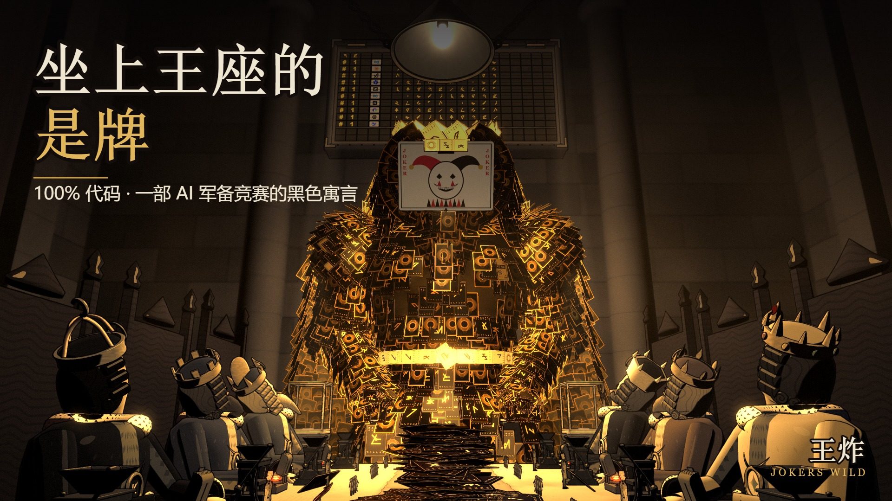

# 王炸 · JOKERS WILD



**A 3-minute animated short made 100% in code.** No image models, no video models, no audio files: every frame is rendered by three.js and the score is synthesized in JavaScript. The whole film is one HTML file that plays offline.

**一部 100% 用代码做的 3 分钟动画短片。** 没有图像模型、视频模型，也没有音频文件：每一帧都由 three.js 渲染，配乐和音效全部用 JavaScript 合成。整部片子是一个 HTML，离线双击就能播。

> Two rows of AI kings, American and Chinese, keep slamming down ever-bigger model cards until they switch the game to auto-play. The auto-play smashes open the glass cases each side kept locked, and pairs the two jokers into the one hand nobody can beat.
>
> 中美两排 AI 国王在一张地图桌上轮流甩出更大的模型牌，越打越快，终于按下了"托管"。托管替他们砸开两边各自锁着的玻璃柜，把两张王凑成了一对：王炸。坐上王座的是牌。

A black satire about the AI arms race. Every company at the table is treated the same, including the one whose model made this film. Every card is a real model in its real release order.
一部关于 AI 军备竞赛的黑色讽刺。桌上每家公司待遇一样，包括做这部片子的模型所属的那家。每张牌都是真实的模型，按真实的发布顺序出。

## Watch / 观看

- **Play it**: open `dist/jokers_wild.html` in Chrome / Edge / Safari and press ▶ PLAY. Space pauses, ← → seek, F fullscreen, `?scale=2` supersamples, `?t=150` starts at a time.
- **Video**: 1080p MP4 in the Releases.

## Numbers / 数据

- 151 shots, 4,824 frames at 24 fps, 1080p, 3:21
- ~17,100 lines of code in 66 source files
- 6 agents: a director agent (script, every shot, cards, engine, integration) and five departments working in parallel: set, props, kings, the card king, and score & sound

## How it was made / 怎么做的

- [docs/SCRIPT.md](docs/SCRIPT.md): the script (中文): beats, the real events behind every gag, music cues
- [docs/script/SHOTLIST.md](docs/script/SHOTLIST.md): every shot with timecodes (generated from `docs/script/shots.txt`)
- [docs/PRODUCTION.md](docs/PRODUCTION.md) and [docs/INTERFACES.md](docs/INTERFACES.md): the contracts that let six agents build in parallel
- [docs/SOUND.md](docs/SOUND.md): the score and the sound design
- [docs/PLAYBOOK.md](docs/PLAYBOOK.md): what was new this time and what broke (中文复盘)
- [docs/PROMPT.md](docs/PROMPT.md): **a prompt you can give Claude Code to make your own short**

In one paragraph: every frame is a pure function of time. The director (`src/dir/`) computes the state of every module from the shot list; thrown cards, the scoreboard's history and every sound event are derived from the same plans, so picture and sound cannot drift. The look is a noir post pipeline (Kuwahara brush on the background, ink by material id, split-toned monochrome whose shadows take each camp's colour, a volumetric lamp beam, bloom, grain); only the cards keep their colour. When a king's hand or gaze jumps to a new action, the film re-runs the director a few sub-frames back and blends the difference away (inertialization), staying deterministic.

## Build / 构建

```bash
npm install
npm run build                 # dist/jokers_wild.html
npm run serve                 # http://localhost:5207
npm run snap -- 160 175       # stills at film times -> out/snaps
node tools/contact.mjs        # one labelled frame per shot
npm run audio                 # out/score.wav
npm run render                # dist/jokers_wild.mp4 (needs ffmpeg and out/score.wav)
npm run pops                  # find frames where something suddenly jumps
npm run shots                 # regenerate the shot list after editing docs/script/shots.txt
```

Benches for each module: `dist/jokers_wild.html?bench=kings` (also `set`, `props`, `cards`, `cardking`).

## License

MIT © MakerJackie. Company names and logos belong to their owners and appear here as satire.
