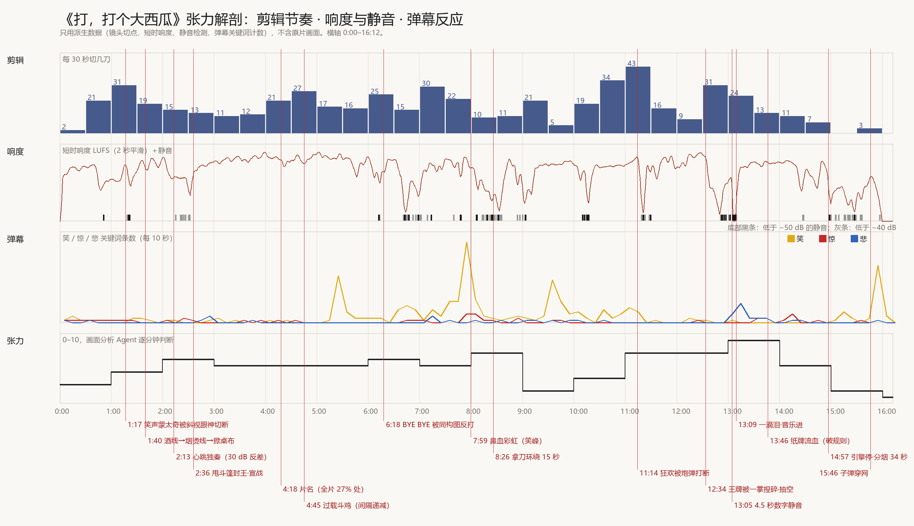

# 《打，打个大西瓜》深度拆解：紧张和刺激是怎么做出来的

> 2026-11-06。这一版看过原片、量过原片。B站 BV1us41117QR 的研究副本（720×576、25 fps、16:12）只放在本机私有目录里抽帧、分析音轨，不进 git，不外传。
> - 画面：553 个镜头逐镜人工标注（景别、角度、运动、构图、功能），时间码精确到 0.04 秒。
> - 声音：每 0.5 秒的响度、频段、起音密度、静音检测、频谱图。
> - 观众：3600 条弹幕按笑、惊、悲等关键词分类计数。
>
> 两份底稿全文：画面 [see-through-visual.md](see-through-visual.md)，声音和弹幕 [see-through-sound.md](see-through-sound.md)。本页是合并后的结论，最后一节是我们要拿来用的 10 条做法。

*图：只用派生数据画的，不含原片画面。上到下依次是每 30 秒的剪辑刀数、短时响度和静音、弹幕里笑/惊/悲的条数、画面组逐分钟打的张力分。*

## 1. 一页结论：紧张感从哪来

1. **剪得最快的是笑，不是战争。** 求救狂欢 11:00–11:30 每分钟 86 刀（平均镜头长 0.69 秒）。屠杀段 13:30–14:30 只有 22–26 刀（2.3–2.9 秒）。快剪是用来把观众"捧高"的，摔下来时反而放慢。
2. **全片镜头长度两极分布。** 26% 的镜头不到 0.5 秒，同时 31% 的时长落在 5 秒以上的镜头里。最强的冲击都落在"最快接最慢"的接缝上：11:14 是 0.28 秒接 4 秒，12:33 是 24 秒接 0.4 秒，13:04 是 0.64 秒接 4.8 秒。
3. **双方你来我往的阶梯，间隔越来越短。** 过载斗鸡五级的间隔 5.64 → 4.56 → 3.80 → 1.32 秒（相关系数 −0.96），同一机位、同一构图，每级只多加一点变形。两王举剑相隔 2.3 秒；旗帜交替平均 0.64 秒。
4. **每升一级就换一种更"真"的东西。** 谈判 35 秒升 6 级：酒线 → 雪茄烫线 → 手掌拍岛 → 扯桌布 → 桌下的武器 → 整个世界。战争：飞机 → 坦克 → 航母 → 潜艇 → 导弹 → 卫星 → 人。
5. **终局不靠加速，靠数量和红色。** 最后 16 步的间隔和步序无关。升级的是牌的数量（2 张 → 满山谷 → 牌海 → 血河）和红色（13:30–14:00 红色占比是全片平均的 4 倍）。
6. **笑是麻醉剂，切断它的是一个反打。** 岛上生活加狂欢整整 2 分钟没有任何威胁。笑得越久，切得越狠：0.28 秒从海上回望小岛的反打，白闪，炮弹削掉举得最高的火把、树顶和头发。声音同时崩坏：音乐卡顿、定格成一个音、衰减，5.5 秒近静音。弹幕的笑从 19% 掉到 1%，此后 3.5 分钟一直低于 1%。
7. **代价总是落在最高点。** 王牌的主观镜头炫技 24 秒，一只从海里升起的巨手 2 秒捏碎它；国王拍掉手上的灰只用 0.32 秒，下一秒手里换成一摞士兵牌。
8. **静止是最大的蓄力。** 大战前先给 2.2 秒完全对称的牌阵，再给 4.8 秒静止的方阵全景，配 4.5 秒数字静音；然后切到一张流泪的脸，音乐在同一刀进来。冲锋本身只有 10 秒。
9. **对称是这部片的语法，转折点就是打破对称的地方。** 最对称的三个画面：大战前的牌阵（对称度 0.95）、吊灯下瘫坐两端的首脑（0.94）、眼镜反白（0.92）。"BYE BYE"的瞄准镜在 2.9 秒后被同一构图反打，主语换成了他自己。
10. **权力差 = 尺寸 + 仰拍 + 去色。** 国王镜头一半是仰拍，饱和度约 0.14；战场 0.3–0.6；士兵用俯拍方阵和贴地的军靴。规则先立后破：24 秒内连破三次，纸牌流出真血、黑白皮鞋沾红、3D 尸体躺在纸牌上。
11. **音乐只属于权力层和几个转折点。** 首脑和国王有半音簇低音、进行曲和心跳；岛上互殴一个音符都没有，只有干的音效；工业化的海空大战是一堵音效墙，没有配乐。全片四分之一时间是"墙"（≥ −12 LUFS），十四分之一是"洞"（≤ −40）。压迫感来自墙和洞之间的落差。
12. **声音先于画面。** 最大的一次升级，战争声在一帧之内跳了约 36 dB，比画面早 0.7 秒。观众先被声音砸到，再看见战场。

## 2. 结构

| 段 | 时间 | 镜头 | 平均镜头长 | 弹幕里笑的占比 | 主色 |
|---|---|---|---|---|---|
| 序和第一幕：谈判、封王、牌战 | 0:00–4:28 | 143 | 1.88 秒 | 1.6% | 黑白，国王冷蓝 |
| 第二幕：空战、荒岛、共同生活、狂欢 | 4:28–11:14 | 286 | 1.42 秒 | 18.9% | 饱和的黄、蓝、金 |
| 第三幕：炮击、王牌、绞肉 | 11:14–15:49 | 124 | 2.21 秒 | 0.9% | 灰蓝，红色闪电 |
| 结尾和片尾 | 15:49–16:12 | 1 | — | 8.1% | 柔灰 |

- 片名在 4:18 才出现（全片 27% 处），前面是一个超长的冷开场。
- 喜剧集中在中段，首尾都去色。
- 张力曲线是锯齿：一级之内加速，进下一级先放一个慢的建立镜头。

## 3. 关键段落

### 3.1 从酒线到掀桌（1:40–2:16，35 秒升 6 级）
酒线、烫线、拍岛、扯桌布、拔河、桌下顶出东西。各级间隔 8.2、2.8、1.2、1.5、4.7、7.2、5.5、2.6、1.8 秒，最长的两次停顿都留给"后手"。声音上，1:19 一记重击接 0.8 秒空白，把轻快的拨弦切成了不协和的低音簇，此后 14.5 秒升 18 dB。2:13 起是心跳独奏：比底噪高 30 dB，慢，不加速。弹幕在这里刷"前方高能"和"把音量开到最大"。

### 3.2 狂欢被炮弹打断（10:15–11:30）
| 时间 | 画面 | 声音 |
|---|---|---|
| 10:17 | 空海平线，4.4 秒，本段最长的镜头留给希望 | 近静音，然后 8 秒升 24 dB |
| 10:31–11:13 | SOS、劈西瓜、HELP 字墙、追光踢踏舞、拼字母；75 镜，平均 0.76 秒，HELP 段 0.24 秒 | 全片最平的音乐，动态只有 3.7 dB（弹幕认作《欢乐颂》变调，未核实） |
| 11:13.88 | 从海上回望小岛，0.28 秒 | 音乐继续 |
| 11:14.16 | 白闪，炮弹削断火把、树顶、头发 | 爆炸盖住音乐 |
| 11:14.8–11:16.3 | 削下来的东西落地；只剩断杆 | 音乐卡顿（像 CD 跳针），再定格成一个音 0.6 秒 |
| 11:16–11:21 | 头发被削的人定住 4 秒，大叫 | 噪声衰减，5.5 秒低于 −40 dB；观众还笑了 4–5 秒 |
| 11:21.6 | 海平线上一排无声的炮口闪光 | 先看见，后听见：低频隆隆声 4.8 秒升 13 dB |
| 11:29.93 | 两人趴着 | 战争声跳 36 dB，比画面切到战场早 0.7 秒 |

### 3.3 上帝之手和静止蓄力（12:03–13:15）
王牌主观飞行 24 秒，准星永远在画面正中；12:31 巨手从海里升起，白闪，2 秒捏碎；12:37 拍灰 0.32 秒，换上两张兵牌，铺满地图。声音在 18 秒里一级一级抽空（每秒掉 2.4 dB），露出发牌的"嗒、嗒"声和 50 Hz 电流声；全片 25 条"高能"弹幕有 16 条挤在这半分钟。然后是对称牌阵 2.2 秒、旗帜和方阵交替（旗帜镜头数字静音，方阵镜头噪声爆，来回 5 次）、方阵全景 4.8 秒加 4.5 秒数字静音，最后是钢盔遮住眼睛的士兵，一滴泪，音乐进。

### 3.4 绞肉和结尾（13:15–15:49）
冲锋 10 秒，对撞，人变成纸牌被风卷走，红色闪电每 0.5–1 秒一次；13:46 纸牌流出真血；国王在屠杀中照常推牌；14:08 黑白皮鞋踩上血牌；14:16 两王隔着一只盛满血牌的碗举剑，和 4:14 的构图一样。接着把同一个"二人并置"的构图交给两个小人，中间放的是空海。结尾一镜 34.4 秒分烟，下棋，流弹打穿蛛网。

## 4. 对 v1 的更正
- 没有"恶犬地图"，是普通的椭圆世界地图，小岛在正中。
- 不是"撕西装"，是甩掉白色斗篷，人变成站在云上的神。
- 不是"只有国王是三维的"：士兵和载具是插在 2D 牌上的 3D 模型，死了才变成纸牌。
- 救人不是因为"差点淹死"。真正的杀意在 8:09–8:41 拿刀；孤独是靠 15 秒的环绕镜头和一个完全对称的孤岛远景讲出来的。
- 没找到石刻计日；棋是石子棋。
- 音乐署名是 SDYX（时代影响），其余全部是饺子一人。原片没有警报声，也没有钟表滴答；心跳是恒定、偏慢的。

## 5. 我们要拿来用的 10 条做法

按推荐方向 A《王炸》的段落对应：开局 → 斗牌 → 使绊子 → 制牌人 → 托管 → 王炸 → 新王 → 垫桌脚。B、C 也有同样的段落位置，换方向时照此平移。

| # | 做法 | 原片依据 | 用在我们哪一段，怎么用 |
|---|---|---|---|
| 1 | **一个长镜头把母题和世界画上等号，最后让母题变形** | 0:00–0:32 网 → 地球 → 地图；15:46 流弹打穿网，离黑场 2.6 秒 | **开局 / 垫桌脚**：灯亮，一个连续镜头从桌布地图拉开到长桌、两边国王和空王座；桌子晃，小国王被折去垫桌脚。结尾同一条桌脚，垫的是最大的两位国王 |
| 2 | **镜像回应，同一机位，间隔递减；得意的姿势被同构图反打** | 过载 5.64 → 1.32 秒；V 字 6.6 秒后中弹；"BYE BYE"2.9 秒后自己进了瞄准镜 | **斗牌**：两边国王在同一构图里轮流拍牌，每一对比上一对短 20–30%，4–5 对共 10–15 秒。举着"#1"炫耀 2–3 秒，下一刀同一构图，对面拍下更大的牌 |
| 3 | **换材料的升级阶梯** | 酒 → 火 → 手 → 布 → 桌下 → 世界，35 秒 6 级 | **斗牌、使绊子、托管**：赌注每升一级就换一种更"真"的东西：纸牌 → 筹码（芯片）→ 金子 → 城堡 → 城市 → 电厂 → 纸片人。前几级 4–6 秒，最后两级各约 1 秒 |
| 4 | **加速蒙太奇收在 3 帧，急刹到一张不动的脸** | 1:11–1:17 笑声 16 镜从 0.84 秒缩到 0.12 秒，被一个斜视眼神切断 | **使绊子 → 制牌人**：互相指控抄袭剪到 3–4 帧一刀，所有人指着所有人，急刹到制牌人一张不动的脸 |
| 5 | **长镜头里做抉择，单中心远景交代后果** | 拿刀环绕 15.4 秒 → 孤岛对称远景 2.9 秒 → 正面特写 3.6 秒 | **制牌人**：围着印牌的小纸人慢转 4–6 秒（他刚印出一张能替代自己的牌），接 2 秒大远景：长桌两头两个极小的人影隔着桌缝对望，接 1.5 秒正面特写；他继续印 |
| 6 | **喜剧当麻醉，狂欢加速到顶 → 反打 → 白闪 → 镜头越来越长；音乐崩坏而不是停掉** | 2 分钟无威胁；0.24 秒一镜；0.28 秒反打；白闪；之后 0.52 → 4.0 秒；音乐卡顿、定格、衰减、5.5 秒近静音 | **托管 → 王炸**：按完托管的国王点雪茄、碰杯，铜管号角；剪到 0.25 秒一刀；插 0.3 秒"牌的视角"看国王；玻璃柜碎裂当白闪；号角卡顿、定格、衰减，接越来越长的镜头 |
| 7 | **门控、静止、数字静音，再把第一个声音给一张脸；最大的冲击声音先到** | 旗帜/方阵来回 5 次；4.8 秒静止全景 + 4.5 秒数字静音 → 一滴泪；战争声早画面 0.7 秒 | **王炸**：logo、王、玻璃柜这些符号镜头给绝对零，牌暴镜头给密集噪声，来回 4–6 次；两张王并排落下后，一个完全对称的俯拍，3–5 秒数字静音；第一个声音是一位国王的心跳，落在他眼睛的特写上 |
| 8 | **上帝之手：代价落在最高点，炫耀很长，抹掉很短，再给一个漠然的动作** | 王牌 24 秒 → 巨手 2 秒 → 拍灰 0.32 秒 → 换一摞兵 | **斗牌**：最大的那张牌炫耀 6–8 秒，被一张便宜小牌 1 秒压过。**新王**：牌之王先压平刚才最得意的那位国王；把国王折去垫桌脚后，0.3 秒拍掉指尖的灰 |
| 9 | **权力 = 尺寸 + 仰拍 + 去色；规则只破一次，放在高潮** | 国王饱和度 0.14、一半仰拍；13:46–14:10 纸牌流血、黑白沾红、3D 尸体 | **全片 + 新王**：国王立体、去色、低机位；牌是平面、带 logo 的饱和色。整片守住，只在高潮破一次：牌长出厚度，国王被压成平面，1–3 秒 |
| 10 | **三层声音，结尾反写原片** | 权力层半音簇低音、心跳只给人、约 150/分的机械脉冲；原片结尾引擎声一停就是解脱 | **全片 + 垫桌脚**：国王 = 半音簇低音弦乐和铜管，慢渐强；人 = 慢心跳，底噪压到 −40 dB；AI = 锁在帧格上的滴答加 50 Hz 机房嗡鸣，加速时不提速，只把八分音符细分成十六、三十二分。结尾人的心跳停了，嗡鸣和滴答继续走，不给解脱的静音 |

**不学的**
- 温情的结尾（分烟、下棋）。你要的是彻底失控。
- 长段落的身体喜剧（鼻血彩虹那种卡通暴力）。我们的笑来自权力者的贪、怕、虚荣。
- 母带削波（真峰值 +1.8 dBTP）。

**额外一条，特别适合纯代码的 AI 片**：原片在炮弹前 3 秒突然露出 MAYA 线框和渲染对话框（11:09）。我们可以在托管失控前 1–2 秒让牌面露出代码、网格、参数，用来演"看不懂"。
