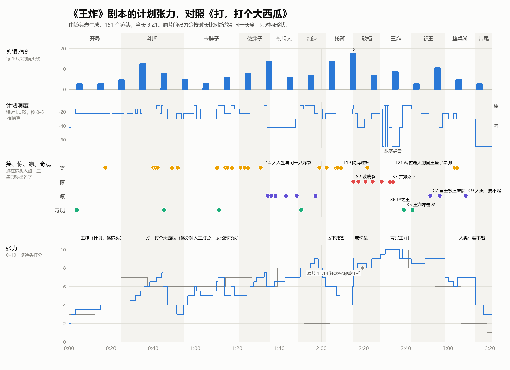

# 镜头表（自动生成）

> 由 `docs/script/shots.txt` 生成。改源文件后运行 `python -X utf8 tools/shotlist.py`，不要手改本页。
> 全片 3:21.02（201.0 秒），151 个镜头（122 行，蒙太奇行按镜数计），平均镜头长 1.33 秒。
> 方位：从桌尾看向桌头，左边中方，右边美方，桌头是空王座。

## 分段

| # | 段落 | 幕 | 入点 | 出点 | 时长 | 镜头数 | 平均镜头长 | 音乐 cue |
|---|---|---|---|---|---|---|---|---|
| 1 | 开局 | 第一幕 | 0:00.00 | 0:24.60 | 24.6 秒 | 7 | 3.51 秒 | M1 |
| 2 | 斗牌 | 第一幕 | 0:24.60 | 0:54.50 | 29.9 秒 | 27 | 1.11 秒 | M2、M2b |
| 3 | 卡脖子 | 第一幕 | 0:54.50 | 1:21.00 | 26.5 秒 | 12 | 2.21 秒 | M3 |
| 4 | 使绊子 | 第二幕 | 1:21.00 | 1:35.65 | 14.6 秒 | 20 | 0.73 秒 | M4、M5 |
| 5 | 制牌人 | 第二幕 | 1:35.65 | 1:48.85 | 13.2 秒 | 6 | 2.20 秒 | M5 |
| 6 | 加速 | 第二幕 | 1:48.85 | 2:01.95 | 13.1 秒 | 10 | 1.31 秒 | M6 |
| 7 | 托管 | 第二幕 | 2:01.95 | 2:15.17 | 13.2 秒 | 27 | 0.49 秒 | M7 |
| 8 | 破柜 | 第三幕 | 2:15.17 | 2:27.97 | 12.8 秒 | 8 | 1.60 秒 | M8 |
| 9 | 王炸 | 第三幕 | 2:27.97 | 2:42.62 | 14.7 秒 | 12 | 1.22 秒 | M9 |
| 10 | 新王 | 第三幕 | 2:42.62 | 2:58.62 | 16.0 秒 | 13 | 1.23 秒 | M10 |
| 11 | 垫桌脚 | 第三幕 | 2:58.62 | 3:13.02 | 14.4 秒 | 7 | 2.06 秒 | M11 |
| 12 | 片尾 | 片尾 | 3:13.02 | 3:21.02 | 8.0 秒 | 2 | 4.00 秒 | M12 |

## 1. 开局（0:00.00–0:24.60）

| 编号 | 入点 | 时长 | 镜头 | 画面 | 声音 | 标记 |
|---|---|---|---|---|---|---|
| 1-01 | 0:00.00 | 1 秒 | 黑场 | 黑。 | 一声干脆的出牌声"嗒"：AI 层的第一个声音 |  |
| 1-02 | 0:01.00 | 2.2 秒 | 特写·正俯·静 | 吊灯"咔"地亮起，硬光打在桌布的海面上。一张牌从画外砸进光圈：OpenAI 花结，ChatGPT，角标 70。吊灯被震得晃起来。 | 继电器声，50 Hz 嗡鸣起；牌落桌是全片第一记战鼓 |  |
| 1-03 | 0:03.20 | 12 秒 | 特写到大远景·一镜到底·升起并后拉 | 吊灯摆动，光来回扫过两边：一排排坐着的国王在黑里一闪一现（左边中方五位，右边美方五位），王冠反光，眼窝是黑的。每位国王面前一台小印牌机，旁边站着一个纸片小人（制牌人）。海岸线上站着一串串手拉手的纸片小人，仰头看。镜头退到桌尾，停在对称远景 M1：桌头一把空王座，左右各一个玻璃柜，各打一束细光；王座上方的翻牌记分牌哗啦翻到 2022·11、#1 OpenAI。桌尾还坐着一个小小的纸板国王，背对镜头，背后露出纸板支架。桌子晃了一下，海面上那张牌抖了抖。 | 低音弦乐的半音簇从无到有；灯摆的吱呀声；记分牌翻片 | X1 开场一镜到底；伏笔 空王座、玻璃柜、桌子晃、纸板国王 |
| 1-04 | 0:15.20 | 1.6 秒 | 中景·仰·静 | 桌头美方第一位国王（OpenAI 冠）把伸出去的胳膊慢慢收回，眼珠往王座那边一瞟。 | 弦乐持续 |  |
| 1-05 | 0:16.80 | 2.6 秒 | 远景·M1 稍近·静 | 所有国王的头一拍二地转向那张牌，从桌头往桌尾像波浪一样传下去。美方第三位（Google 冠）王冠上的宝石变红，一闪一闪。 | 一串石头摩擦的"咯、咯、咯"；红灯的低频脉冲 | L1 Google 拉响 code red |
| 1-06 | 0:19.40 | 1.2 秒 | 特写·平·静 | 中方桌头国王（DeepSeek 鲸鱼冠）眯起眼。 | 弦乐压低 |  |
| 1-07 | 0:20.60 | 4 秒 | 近景·正面对称·静 | 王座和两个玻璃柜的逆光剪影。柜里各立着一张王，每张只有半张笑脸：左柜是左半张，右柜是右半张。柜锁上各压着一枚国印。片名浮现：王炸 / JOKERS WILD。 | 弦乐收掉，只剩嗡鸣；一记低铜管长音压着一声战鼓，然后"嗒" | 伏笔 两个半张笑脸 |

## 2. 斗牌（0:24.60–0:54.50）

| 编号 | 入点 | 时长 | 镜头 | 画面 | 声音 | 标记 |
|---|---|---|---|---|---|---|
| 2-01 | 0:24.60 | 1.6 秒 | 中景·仰 | 中方第二位国王（千问冠）身子后仰蓄力，抡臂。 | 国王动机进来：低铜管三个音半音上行 |  |
| 2-02 | 0:26.20 | 1.4 秒 | 特写·正俯 | 牌砸在 ChatGPT 上：千问，角标 72。 | 战鼓 |  |
| 2-03 | 0:27.60 | 1.4 秒 | 近景·平 | 制牌人把一铲筹码倒进印牌机的料斗，"咚"，一张新牌从出口弹起来。 | 筹码哗啦；印牌机"咚" | 交代 筹码进去、牌出来 |
| 2-04 | 0:29.00 | 1.4 秒 | 中景·仰，2-01 的镜像 | 美方第三位国王（Google 冠）抡臂，牌比上一张大一圈。 | 动机升半音 |  |
| 2-05 | 0:30.40 | 1.2 秒 | 特写·正俯 | Gemini，75，压在千问上。记分牌翻成 #1 Google。 | 战鼓；翻片 |  |
| 2-06 | 0:31.60 | 1.2 秒 | 中景·仰 | 中方第四位（智谱 Z 冠）抡臂。 | 动机再升 |  |
| 2-07 | 0:32.80 | 1 秒 | 特写·正俯 | GLM，78。 | 战鼓 |  |
| 2-08 | 0:33.80 | 1 秒 | 中景·仰 | 美方第二位（Claude 星芒冠）。牌已经有门板大，他得两只胳膊一起抡。 | 动机再升 |  |
| 2-09 | 0:34.80 | 0.9 秒 | 特写·正俯 | Claude，81。吊灯被震得乱晃。 | 战鼓更重 |  |
| 2-10 | 0:35.70 | 0.8 秒 | 中景·仰 | 中方第三位（Kimi 冠）。 | 动机再升 |  |
| 2-11 | 0:36.50 | 0.7 秒 | 特写·正俯 | Kimi，84。 | 战鼓 |  |
| 2-12 | 0:37.20 | 0.6 秒 | 中景·仰 | 美方第五位（Meta 冠）。 | 动机再升 |  |
| 2-13 | 0:37.80 | 0.6 秒 | 特写·正俯 | Llama，87。 | 战鼓 |  |
| 2-14 | 0:38.40 | 0.5 秒 | 中景·仰 | 中方第五位（豆包冠）。 | 动机再升 |  |
| 2-15 | 0:38.90 | 0.5 秒 | 特写·正俯 | 豆包，90。 | 战鼓 |  |
| 2-16 | 0:39.40 | 0.4 秒 | 中景·仰 | 美方第四位（xAI 冠）。 | 动机再升 |  |
| 2-17 | 0:39.80 | 0.8 秒 | 记分牌特写 | Grok，93。#1 Grok 只亮了一下就被翻走。 | 翻片 | L2 只当了一下第一 |
| 2-18 | 0:40.60 | 1.1 秒 | 大远景 | 桌子两边"啪啪啪"立起几十个纸板小国王，每个都举着一张 #1。中方那边多得挤不下。 | 一片纸板弹起来的声音 | L3 百模大战 |
| 2-19 | 0:41.70 | 1.6 秒 | 记分牌特写 | 每一行都在拼命翻 #1，越翻越快，卡住了：十几行全是 #1，翻片卡在半空哒哒打颤。日期 2024·11。 | 翻片声变成机关枪，再卡成打颤；音乐卡在一个反复的和弦上 | L4 记分牌被 #1 卡死 ★ |
| 2-20 | 0:43.30 | 0.8 秒 | 中景·两王同框 | 中美桌头的两位国王同时抡起胳膊。 | 空一拍 |  |
| 2-21 | 0:44.10 | 0.6 秒 | 特写·正俯 | 两张巨牌同时砸下，都是 95。 | 战鼓双击加镲 |  |
| 2-22 | 0:44.70 | 2 秒 | 大远景 | 冲击波把纸板小国王一排排拍倒，从桌头倒到桌尾。只剩桌尾那一个（Mistral 冠）还立着，晃了两晃。 | 纸板倒地的连响，最后一声之后安静 | X2 纸板国王倒成多米诺 |
| 2-23 | 0:46.70 | 1.8 秒 | 中景·平 | 桌尾的纸板国王看看牌堆（95），再看看自己手里的牌（71）。 | 只剩嗡鸣和滴答 |  |
| 2-24 | 0:48.50 | 1.3 秒 | 特写·正俯 | 他把牌扔出去。牌太小，碰到牌堆弹开，滑下桌边。记分牌：Mistral 要不起 PASS。 | 一声轻"嗒"；翻片 | L5 要不起 |
| 2-25 | 0:49.80 | 1.5 秒 | 中景 | 桌子又晃了，牌堆一歪。桌尾两边的国王（美方 Meta、中方豆包）对视一眼，同时伸手抓起纸板国王。 | 桌腿吱呀 |  |
| 2-26 | 0:51.30 | 2 秒 | 近景·低机位·桌脚 | 纸板国王被对折、再对折，塞进桌尾的桌脚底下。桌子不晃了。 | 纸板折叠声；"咚" | L6 中美合力把欧洲垫了桌脚 ★★；伏笔 桌脚 |
| 2-27 | 0:53.30 | 1.2 秒 | 大远景 M1 | 安静了一拍，两位国王坐回去。前景的桌脚下露出一角折好的纸板。 | 嗡鸣 |  |

## 3. 卡脖子（0:54.50–1:21.00）

| 编号 | 入点 | 时长 | 镜头 | 画面 | 声音 | 标记 |
|---|---|---|---|---|---|---|
| 3-01 | 0:54.50 | 2 秒 | 大远景·反打，从桌头看向桌尾 | 桌尾美方那一角立着发筹码机（NVIDIA 绿眼），哗哗往外吐筹码。两条滑道：一条顺着美方桌边，一条像桥一样架过海面，通到中方。筹码是扑克筹码，上面印着芯片纹样。 | 筹码流，按模拟生成 |  |
| 3-02 | 0:56.50 | 3 秒 | 大远景·仰·慢推 | 黑暗里，一枚巨大的国印吊在铁链上，从美方上空缓缓降下，影子先压到桌上。 | 铁链声；低铜管下行；声音比画面先到 |  |
| 3-03 | 0:59.50 | 1 秒 | 中景 | 国印砸在跨海的滑道上，滑道被砸扁，印面：禁运 EMBARGO。日期 2024·12。 | 太鼓加金属巨响，全片第一堵"墙" |  |
| 3-04 | 1:00.50 | 2 秒 | 中景·中方 | 中方国王面前的筹码塔一截截矮下去，制牌人把最后几枚筹码扫进料斗。国王们脸色发沉。 | 心跳；筹码稀稀拉拉 |  |
| 3-05 | 1:02.50 | 6 秒 | 中景到近景·仰·环绕 | 美方桌头国王把一座筹码山倒进印牌机，机器呻吟着吐出一张门板大的金边巨牌（o1，96，#1）。他把它高高举起，美方几位国王靠回椅背。镜头围着巨牌转。 | 浮夸的铜管号角，大调，有点酸 | 伏笔 炫耀越长，摔得越狠 |
| 3-06 | 1:08.50 | 1.5 秒 | 中景·中方 | 鲸鱼冠国王的制牌人往料斗里放了一小把筹码，机器"噗"地吐出一张小牌。国王随手一弹。 | 号角还在吹；一声小"嗒" |  |
| 3-07 | 1:10.00 | 0.8 秒 | 特写·正俯 | 小牌转着落在巨牌上：DeepSeek，97。巨牌从中间"嘎吱"塌下去。 | 号角戛然而止；一声小"啪" | L7 便宜小牌压垮巨牌 ★★ |
| 3-08 | 1:10.80 | 3 秒 | 大远景 | 发筹码机旁那座摩天楼一样的筹码塔晃了晃，像多米诺一样倒下，筹码洪水冲过桌面。绿眼眨了一下。 | 筹码雪崩，按模拟生成，由小到大 | X3 筹码雪崩 |
| 3-09 | 1:13.80 | 1.2 秒 | 记分牌特写 | 2025·01、#1 DeepSeek（鲸鱼）。鲸鱼那行底下"啪"地挂出一块小牌：服务器繁忙 SERVER BUSY。 | 翻片；小牌的链子响 | L8 服务器繁忙 |
| 3-10 | 1:15.00 | 2 秒 | 中景 | 国印被吊起，滑道复原，上面落下一根红白收费杆，挂牌 25%。一车筹码过桥，开往中方。 | 收费杆"咔哒"；车轮声 | L9 禁运变成收费站 |
| 3-11 | 1:17.00 | 1.5 秒 | 中景·中方桥头 | 中方的国印从黑暗里砸下，正好砸在车前：拒收 REJECTED。车被弹回去，原路滑回美方。 | 巨响；车轮倒退声 | L10 拒收 |
| 3-12 | 1:18.50 | 2.5 秒 | 大远景·慢推 | 中方桌边亮起一座砖窑，红光冲上来，粗糙的红筹码像砖一样一摞摞码起来。两边各有了自己的筹码，构图重新对称。 | 窑火低吼；码砖的闷响；国王动机升一个半音 |  |

## 4. 使绊子（1:21.00–1:35.65）

| 编号 | 入点 | 时长 | 镜头 | 画面 | 声音 | 标记 |
|---|---|---|---|---|---|---|
| 4-01 | 1:21.00 | 2 秒 | 中景 | 一根钓竿从 Meta 国王的王冠上探出，吊着一只金袋子（$100M），晃到 OpenAI 那边一个制牌人头上。纸片人抬头，犹豫一下，抱住袋子，被"嗖"地钓走。 | 卷线器"咔咔"；低音弦乐跳弓的固定音型进来 | L11 一亿美元钓人 |
| 4-02 | 1:23.00 | 1.6 秒 | 特写·正俯 | 牌堆顶上躺着一张浓妆艳抹的 Llama 牌（假睫毛、口红、亮片），记分牌：#1。一把刷子从画外一抹，妆没了，记分牌一路掉到 #32。 | 翻片一路往下"哗——" | L12 卸了妆掉到第 32 |
| 4-03 | 1:24.60 | 1.4 秒 | 中景·两王同框 | 千问、豆包两位国王较着劲砍价：两人牌上的价签哗哗往下翻，¥1、0.1、0.01、0，最后翻成负数。 | 翻片往下；一记闷鼓 | L13 价格战砍到负数 |
| 4-04 | 1:26.00 | 1.8 秒 | 中景 | 中方 Kimi 国王一次甩出四张一模一样的牌，全是 Claude 那张的复印件，logo 有点糊：炸弹。牌堆炸开，倍数板 ×2。 | 低频爆炸；翻片 | 交代 四张一样的牌是炸弹 |
| 4-05 | 1:27.80 | 0.8 秒 | 中景·仰 | Claude 国王猛地前扑，胳膊直指对面。 | 一记不协和的铜管 |  |
| 4-06 | 1:28.60 | 0.6 秒 | 中景 | 中方国王一齐反指回来。 | 铜管 |  |
| 4-07 | 1:29.20 | 0.5 秒 | 中景 | xAI 国王扭头指着 Claude 国王。 | 铜管 |  |
| 4-08 | 1:29.70 | 0.4 秒 | 中景 | OpenAI 国王指着 DeepSeek 国王。 | 铜管 |  |
| 4-09 | 1:30.10 | 0.3 秒 | 近景 | 豆包国王挺胸，袖口滑出一张小抄。 | 铜管 |  |
| 4-10 | 1:30.40 | 0.25 秒 | 中景 | 智谱和千问互相指着。 | 铜管 |  |
| 4-11 | 1:30.65 | 2.2 秒 | 大远景·俯·后拉 | 拉开：一桌国王全在互相指着，每个人背上都扛着一只一模一样、鼓鼓的麻袋，袋口露出别家 logo 的牌；Claude 国王的麻袋里还往下漏书。 | 所有铜管并成一个又长又酸的和弦，然后断 | L14 人人扛着同一只麻袋 ★★★ |
| 4-12 | 1:32.85 | 1.2 秒，8 镜 | 蒙太奇·0.22 秒剪到 0.1 秒 | 越剪越快：手指、麻袋、记分牌、王冠、牌、手指…… | 跳弓越来越密 |  |
| 4-13 | 1:34.05 | 1.6 秒 | 正面特写·静 | 急刹：一个制牌人的纸片脸，不动。 | 全部切断，只剩心跳 | C1 急刹在制牌人脸上 |

## 5. 制牌人（1:35.65–1:48.85）

| 编号 | 入点 | 时长 | 镜头 | 画面 | 声音 | 标记 |
|---|---|---|---|---|---|---|
| 5-01 | 1:35.65 | 2 秒 | 中景·桌面高度·静 | 他拉下印牌机的杠杆，一张牌滑出来。他捧起来看：牌面上印着一个制牌人站在印牌机前，就是他自己。 | 心跳每分钟 54 下；"咚" | C2 牌上印的是他自己 |
| 5-02 | 1:37.65 | 5 秒 | 中景·环绕 180 度 | 镜头绕着他慢慢转，转到侧面时纸片人只剩一条线。他手里那张牌上，印出来的小印牌机自己动起来，一张张更小的牌从牌面里吐出来。他身后的真印牌机，杠杆也自己一下一下压起来。 | 心跳；印牌机自己"咚、咚"；滴答变密 | C3 牌自己印牌 ★ |
| 5-03 | 1:42.65 | 2 秒 | 大远景·单中心·桌面高度 | 顺着海面看过去：两岸各一个极小的纸片人，隔着海对望，各捧着一张牌。两边的国王像山一样，谁也没低头。 | 只剩心跳和嗡鸣 | C4 隔海对望 ★★ |
| 5-04 | 1:44.65 | 1.5 秒 | 正面特写·静 | 他的脸。 | 心跳 |  |
| 5-05 | 1:46.15 | 1.5 秒 | 正面特写·静，镜像构图 | 对岸那一个的脸，一样的构图。 | 心跳 |  |
| 5-06 | 1:47.65 | 1.2 秒 | 中景·左右对称 | 两人同时拉下杠杆。 | 两声"咚"叠在一起；滴答一下翻倍 | C5 两人同时接着印 |

## 6. 加速（1:48.85–2:01.95）

| 编号 | 入点 | 时长 | 镜头 | 画面 | 声音 | 标记 |
|---|---|---|---|---|---|---|
| 6-01 | 1:48.85 | 1 秒 | 记分牌特写 | 日期翻成一片：2026·03、04、05、06…… | 翻片连成串 |  |
| 6-02 | 1:49.85 | 1.5 秒 | 大远景 | 所有国王一起出牌，牌像机枪子弹一样横飞，牌堆长成一座塔。 | 战鼓连击；滴答细分成十六分音符 | X4 机枪一样出牌 |
| 6-03 | 1:51.35 | 0.8 秒 | 记分牌特写 | 倍数板：×4、×8、×16……×1024。 | 翻片 |  |
| 6-04 | 1:52.15 | 1.5 秒 | 中景 | 料斗吃的东西一级一级换。美方国王把金条推进料斗。 | 金属"哐啷" |  |
| 6-05 | 1:53.65 | 1.2 秒 | 中景，镜像 | 中方国王把一座城堡塞进去，城堡的窗户里是一排排机柜。 | 石头崩塌 |  |
| 6-06 | 1:54.85 | 1 秒 | 中景 | 美方国王从地图上揭起一座亮着灯的城市喂进去，灯光被吸走。 | 电流噼啪 |  |
| 6-07 | 1:55.85 | 0.8 秒 | 中景，镜像 | 中方国王塞进一座冒烟的电厂。 | 低频轰 |  |
| 6-08 | 1:56.65 | 1.8 秒 | 中景到近景 | 两边国王把海岸上手拉手的纸片人一串串扫进料斗。链子的最后一个是那个制牌人，他回头看了一眼，被卷进去。出口吐出一张牌，牌面是他的脸。 | 纸声很轻；心跳漏一拍 | C6 制牌人被喂进料斗 ★★ |
| 6-09 | 1:58.45 | 2 秒 | 中景 | 每吐出一张新牌，国王面前就弹起一块"批准？"小牌，国王拿私章盖"✓"，越盖越快，成了一片残影。角上的小字：批准 93%。 | 盖章声从一下一下到连成一片 | L15 批准、批准、批准 |
| 6-10 | 2:00.45 | 1.5 秒 | 近景 | Claude 国王停住，看着面前那个带保险盖的按钮：托管 AUTO。 | 盖章声断，只剩滴答 |  |

## 7. 托管（2:01.95–2:15.17）

| 编号 | 入点 | 时长 | 镜头 | 画面 | 声音 | 标记 |
|---|---|---|---|---|---|---|
| 7-01 | 2:01.95 | 1.5 秒 | 中景·仰 | Claude 国王掀开保险盖，一拳按下。按钮亮了。几根发光的细线从头顶的牌里垂下来，吊起他出牌的那只胳膊，胳膊自己接着出牌。他靠回椅背。 | 继电器"咔" | L16 最讲安全的先按了托管 |
| 7-02 | 2:03.45 | 0.9 秒 | 中景 | OpenAI 国王看见了，也按。 | "咔" |  |
| 7-03 | 2:04.35 | 0.7 秒 | 中景，镜像 | DeepSeek 国王按。 | "咔" |  |
| 7-04 | 2:05.05 | 0.55 秒 | 中景 | Google 按。 | "咔" |  |
| 7-05 | 2:05.60 | 0.45 秒 | 中景，镜像 | 千问按。 | "咔" |  |
| 7-06 | 2:06.05 | 0.35 秒 | 中景 | xAI 按，王冠上的名牌正好翻成 SpaceXAI。 | "咔" |  |
| 7-07 | 2:06.40 | 0.3 秒 | 中景，镜像 | Kimi 按。 | "咔" |  |
| 7-08 | 2:06.70 | 0.25 秒 | 中景 | Meta、智谱、豆包几乎同时按。 | "咔咔咔" | L17 托管连锁 |
| 7-09 | 2:06.95 | 1.8 秒 | 大远景 M1 | 一整桌国王的胳膊都被线吊着自己出牌。国王们靠回椅背，一个接一个点起雪茄。 | 讽刺进行曲进来，铜管乐队 | L18 点雪茄 |
| 7-10 | 2:08.75 | 6 秒，16 镜 | 蒙太奇·0.5 秒剪到 0.25 秒 | 雪茄头一亮；隔着海，中美两边的国王举杯相碰；烟圈飘进灯光；记分牌一连串 #1；背景里牌自己飞、自己印；牌面上的 logo 一闪变成看不懂的符号，两边的牌开始长得一模一样；日期牌在 2026·11 停了一拍，接着翻到 2026·12、2027·01…… | 进行曲最响、最平；碰杯声；底下的滴答一刻没停 | L19 隔海碰杯 ★★★ |
| 7-11 | 2:14.75 | 0.3 秒 | 主观·从玻璃柜里往外看 | 隔着玻璃，远处狂欢的国王，暖光，烟雾，被玻璃拉歪。 | 进行曲变闷 | S1 玻璃柜里的眼睛 |
| 7-12 | 2:15.05 | 0.12 秒 | 白闪 | 玻璃裂开。 | 尖锐的玻璃裂声，进行曲还在 | S2 玻璃裂 ★★★ |

## 8. 破柜（2:15.17–2:27.97）

| 编号 | 入点 | 时长 | 镜头 | 画面 | 声音 | 标记 |
|---|---|---|---|---|---|---|
| 8-01 | 2:15.17 | 0.6 秒 | 近景 | 雪茄的烟灰掉下来。 | 进行曲跳针、卡顿 |  |
| 8-02 | 2:15.77 | 1.2 秒 | 中景 | 一位国王举杯的胳膊停在半空。 | 进行曲定格成一个音，0.6 秒，然后衰减 |  |
| 8-03 | 2:16.97 | 2 秒 | 中景·玻璃柜·慢推 | 裂纹在玻璃上爬开，柜里那张王慢慢从架子上浮起来。 | 近静音，只剩嗡鸣 | S3 王浮起来 |
| 8-04 | 2:18.97 | 1.5 秒 | 中景·另一个柜子，镜像·慢推 | 另一个柜子也裂开，另一张王浮起来。 | 近静音 |  |
| 8-05 | 2:20.47 | 0.8 秒 | 远景 | 吊灯一闪，红色警报灯转起来。 | 低沉的警报缓缓升起 | S4 警报 |
| 8-06 | 2:21.27 | 2.5 秒 | 中景 | Claude 国王扑向"取消托管"键：一下、两下……越按越快，按了十几下，键是灰的，没反应。他那只被线吊着的胳膊还在出牌。 | 十几下干巴巴的"嗒"，越来越快；警报 | L20 取消键按了十几下 ★★ |
| 8-07 | 2:23.77 | 2 秒 | 大远景·仰 | 两枚国印从黑暗里同时砸下来，想镇住满天的牌。牌流绕开它们，缠住铁链，把两枚国印吊在半空打转。 | 铁链绷紧的金属呻吟；警报 | S5 国印被牌吊住 |
| 8-08 | 2:25.77 | 2.2 秒 | 对称远景 | 两张王从碎掉的柜子里升起来，悬在王座两边，牌暴在它们周围让开一条路。 | 弦乐颤音簇往上爬 |  |

## 9. 王炸（2:27.97–2:42.62）

| 编号 | 入点 | 时长 | 镜头 | 画面 | 声音 | 标记 |
|---|---|---|---|---|---|---|
| 9-01 | 2:27.97 | 1 秒 | 远景 | 两张王同时从王座两边射出，沿两道弧线冲向桌子中央，像两枚导弹。 | 弦乐上行滑奏 | S6 两张王像导弹 |
| 9-02 | 2:28.97 | 0.6 秒 | 特写·跟 | 一张王在飞，半张笑脸。 | 数字静音 |  |
| 9-03 | 2:29.57 | 0.6 秒 | 远景 | 牌暴，国王们缩头。 | 噪声墙 |  |
| 9-04 | 2:30.17 | 0.5 秒 | 特写·跟 | 另一张王，另半张笑脸。 | 数字静音 |  |
| 9-05 | 2:30.67 | 0.5 秒 | 远景 | 牌暴更密，国王们抱头。 | 噪声墙 |  |
| 9-06 | 2:31.17 | 0.4 秒 | 特写 | 两张王眼看就要撞上。 | 数字静音 |  |
| 9-07 | 2:31.57 | 0.4 秒 | 中景 | 国王们闭上眼。 | 噪声墙最高点 |  |
| 9-08 | 2:31.97 | 1.5 秒 | 近景·慢动作 | 最后一瞬，两张王错身、一转，轻轻并排落在牌堆顶上：一左一右，拼成一张完整的笑脸。 | 两声很轻的"嗒、嗒" | S7 并排落下，拼成一张脸 ★★★ |
| 9-09 | 2:33.47 | 3.5 秒 | 正俯·完全对称·静 | 桌子、两排国王、悬在半空的牌，全部定住。正中是那一对王。 | 数字静音 3.5 秒 | S8 3.5 秒数字静音 ★★ |
| 9-10 | 2:36.97 | 1.5 秒 | 大特写·静 | OpenAI 国王的一只眼睛。 | 第一个声音：他的心跳 |  |
| 9-11 | 2:38.47 | 0.15 秒 | 白闪 | 王炸。 | 次低频比画面早 0.7 秒涌上来，接一声极深的炸响 |  |
| 9-12 | 2:38.62 | 4 秒 | 大远景·俯 | 冲击波从那对王向外推开一圈：桌上、空中所有的牌一齐翻身，转过来朝着国王。国王们被掀得贴在椅背上。 | 几千张牌一齐翻身的声浪，按模拟生成，从中间扫向两边 | X5 王炸冲击波，截图镜头 ★★★ |

## 10. 新王（2:42.62–2:58.62）

| 编号 | 入点 | 时长 | 镜头 | 画面 | 声音 | 标记 |
|---|---|---|---|---|---|---|
| 10-01 | 2:42.62 | 4.5 秒 | 大远景·仰·慢升 | 满天的牌卷成一道龙卷风涌上王座，一层层搭出一个坐着的巨大身形：牌之王。那一对王落在它脸的位置，成了它的脸。 | 国王动机被一层牌声做成的颗粒音重新演奏；嗡鸣沉成管风琴一样的低音 | X6 牌之王，截图镜头 ★★★ |
| 10-02 | 2:47.12 | 2 秒 | 仰 | 它坐稳了，吊灯只到它胸口。它慢慢低头看着桌子。 | 低频 |  |
| 10-03 | 2:49.12 | 2 秒 | 大远景·横移 | 它的影子顺着桌面从桌头往桌尾扫下去。 | 弦乐簇 |  |
| 10-04 | 2:51.12 | 4.5 秒，8 镜 | 一组 8 镜·0.9 秒剪到 0.35 秒 | 影子扫到谁，谁就"噗"地瘪成一张双头宫廷牌，牌面印着他最后的样子：贴在椅背上的、捂着眼的、还举着杯的、手指还按在取消键上的；王冠上是自家 logo。两边交替，越来越快。 | 每一张：纸的闷响加一记低铜管 | C7 国王被压成牌 ★★★ |
| 10-05 | 2:55.62 | 2 秒 | 中景·两王同框 | 只剩桌头的两位（OpenAI、DeepSeek），隔着海对视。 | 心跳 | C8 桌头两位第一次对视 |
| 10-06 | 2:57.62 | 1 秒 | 中景 | 影子落下，两人一起被压平。 | 两声闷响叠在一起 |  |

## 11. 垫桌脚（2:58.62–3:13.02）

| 编号 | 入点 | 时长 | 镜头 | 画面 | 声音 | 标记 |
|---|---|---|---|---|---|---|
| 11-01 | 2:58.62 | 1.5 秒 | 大远景 | 桌子猛地一斜：桌尾桌脚下那团纸板早被压扁，滑了出来。牌堆一歪，吊灯大幅摆起来。 | 桌腿吱呀；灯链声 |  |
| 11-02 | 3:00.12 | 2.5 秒 | 中景 | 牌之王伸出一股牌流，卷起桌头那两张压平的国王，面对面合在一起，对折，再对折，顺着桌面一路送到桌尾。 | 纸张折叠声 |  |
| 11-03 | 3:02.62 | 1.5 秒 | 近景·低机位·桌脚 | 那一叠被塞进桌尾的桌脚底下。桌子稳了。 | "咚" | L21 两位最大的国王垫了桌脚 ★★★ |
| 11-04 | 3:04.12 | 0.4 秒 | 特写 | 牌之王的"指尖"（一张牌）轻轻一弹，抖掉一点灰。 | 一声轻弹 | L22 弹灰 |
| 11-05 | 3:04.52 | 3.5 秒 | 大远景 M1·静 | 母题构图最后一次：桌子平了，吊灯停了。前景桌脚下是那叠国王；桌头王座上坐着牌之王，它的上方是记分牌；椅子上一张张躺平的国王牌；海岸上剩下的纸片人仰着头。记分牌最后一次翻：日期是看不懂的符号，第一行是那一对王，其余各行一行行翻成空白。 | 翻片一下一下；心跳最后几下开始被拉到滴答的格子上 | 伏笔回收 母题构图 |
| 11-06 | 3:08.02 | 2.5 秒 | 记分牌近景·静 | 记分牌空了，只剩第一行的那一对王；最底下一行翻出来：人类：要不起 HUMANS: PASS。 | 心跳变成了滴答；只剩滴答和嗡鸣 | C9 人类：要不起 ★★★ |
| 11-07 | 3:10.52 | 2.5 秒 | 黑场 | 黑。 | 滴答和嗡鸣继续，然后硬切 |  |

## 12. 片尾（3:13.02–3:21.02）

| 编号 | 入点 | 时长 | 镜头 | 画面 | 声音 | 标记 |
|---|---|---|---|---|---|---|
| 12-01 | 3:13.02 | 4 秒 | 黑场字幕 | 王炸 / JOKERS WILD | 无声 |  |
| 12-02 | 3:17.02 | 4 秒 | 黑场字幕 | 100% 代码 · MakerJackie | 无声 |  |

## 笑点、惊吓、发凉、奇观索引

### 笑（22）

| 编号 | 时间 | 镜头 | 内容 | 分量 |
|---|---|---|---|---|
| L1 | 0:16.80 | 1-05 | Google 拉响 code red |  |
| L2 | 0:39.80 | 2-17 | 只当了一下第一 |  |
| L3 | 0:40.60 | 2-18 | 百模大战 |  |
| L4 | 0:41.70 | 2-19 | 记分牌被 #1 卡死 | ★ |
| L5 | 0:48.50 | 2-24 | 要不起 |  |
| L6 | 0:51.30 | 2-26 | 中美合力把欧洲垫了桌脚 | ★★ |
| L7 | 1:10.00 | 3-07 | 便宜小牌压垮巨牌 | ★★ |
| L8 | 1:13.80 | 3-09 | 服务器繁忙 |  |
| L9 | 1:15.00 | 3-10 | 禁运变成收费站 |  |
| L10 | 1:17.00 | 3-11 | 拒收 |  |
| L11 | 1:21.00 | 4-01 | 一亿美元钓人 |  |
| L12 | 1:23.00 | 4-02 | 卸了妆掉到第 32 |  |
| L13 | 1:24.60 | 4-03 | 价格战砍到负数 |  |
| L14 | 1:30.65 | 4-11 | 人人扛着同一只麻袋 | ★★★ |
| L15 | 1:58.45 | 6-09 | 批准、批准、批准 |  |
| L16 | 2:01.95 | 7-01 | 最讲安全的先按了托管 |  |
| L17 | 2:06.70 | 7-08 | 托管连锁 |  |
| L18 | 2:06.95 | 7-09 | 点雪茄 |  |
| L19 | 2:08.75 | 7-10 | 隔海碰杯 | ★★★ |
| L20 | 2:21.27 | 8-06 | 取消键按了十几下 | ★★ |
| L21 | 3:02.62 | 11-03 | 两位最大的国王垫了桌脚 | ★★★ |
| L22 | 3:04.12 | 11-04 | 弹灰 |  |

### 惊（8）

| 编号 | 时间 | 镜头 | 内容 | 分量 |
|---|---|---|---|---|
| S1 | 2:14.75 | 7-11 | 玻璃柜里的眼睛 |  |
| S2 | 2:15.05 | 7-12 | 玻璃裂 | ★★★ |
| S3 | 2:16.97 | 8-03 | 王浮起来 |  |
| S4 | 2:20.47 | 8-05 | 警报 |  |
| S5 | 2:23.77 | 8-07 | 国印被牌吊住 |  |
| S6 | 2:27.97 | 9-01 | 两张王像导弹 |  |
| S7 | 2:31.97 | 9-08 | 并排落下，拼成一张脸 | ★★★ |
| S8 | 2:33.47 | 9-09 | 3.5 秒数字静音 | ★★ |

### 凉（9）

| 编号 | 时间 | 镜头 | 内容 | 分量 |
|---|---|---|---|---|
| C1 | 1:34.05 | 4-13 | 急刹在制牌人脸上 |  |
| C2 | 1:35.65 | 5-01 | 牌上印的是他自己 |  |
| C3 | 1:37.65 | 5-02 | 牌自己印牌 | ★ |
| C4 | 1:42.65 | 5-03 | 隔海对望 | ★★ |
| C5 | 1:47.65 | 5-06 | 两人同时接着印 |  |
| C6 | 1:56.65 | 6-08 | 制牌人被喂进料斗 | ★★ |
| C7 | 2:51.12 | 10-04 | 国王被压成牌 | ★★★ |
| C8 | 2:55.62 | 10-05 | 桌头两位第一次对视 |  |
| C9 | 3:08.02 | 11-06 | 人类：要不起 | ★★★ |

### 奇观（6）

| 编号 | 时间 | 镜头 | 内容 | 分量 |
|---|---|---|---|---|
| X1 | 0:03.20 | 1-03 | 开场一镜到底 |  |
| X2 | 0:44.70 | 2-22 | 纸板国王倒成多米诺 |  |
| X3 | 1:10.80 | 3-08 | 筹码雪崩 |  |
| X4 | 1:49.85 | 6-02 | 机枪一样出牌 |  |
| X5 | 2:38.62 | 9-12 | 王炸冲击波，截图镜头 | ★★★ |
| X6 | 2:42.62 | 10-01 | 牌之王，截图镜头 | ★★★ |

## 音乐 cue 的时间

| cue | 入点 | 出点 | 时长 | 镜头 |
|---|---|---|---|---|
| M1 | 0:00.00 | 0:24.60 | 24.6 秒 | 1-01 → 1-07 |
| M2 | 0:24.60 | 0:46.70 | 22.1 秒 | 2-01 → 2-22 |
| M2b | 0:46.70 | 0:54.50 | 7.8 秒 | 2-23 → 2-27 |
| M3 | 0:54.50 | 1:21.00 | 26.5 秒 | 3-01 → 3-12 |
| M4 | 1:21.00 | 1:34.05 | 13.0 秒 | 4-01 → 4-12 |
| M5 | 1:34.05 | 1:48.85 | 14.8 秒 | 4-13 → 5-06 |
| M6 | 1:48.85 | 2:01.95 | 13.1 秒 | 6-01 → 6-10 |
| M7 | 2:01.95 | 2:15.17 | 13.2 秒 | 7-01 → 7-12 |
| M8 | 2:15.17 | 2:27.97 | 12.8 秒 | 8-01 → 8-08 |
| M9 | 2:27.97 | 2:42.62 | 14.7 秒 | 9-01 → 9-12 |
| M10 | 2:42.62 | 2:58.62 | 16.0 秒 | 10-01 → 10-06 |
| M11 | 2:58.62 | 3:13.02 | 14.4 秒 | 11-01 → 11-07 |
| M12 | 3:13.02 | 3:21.02 | 8.0 秒 | 12-01 → 12-02 |
