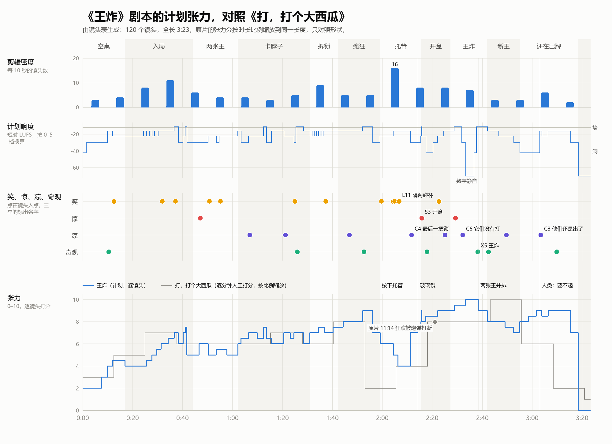

# 镜头表（自动生成）

> 由 `docs/script/shots.txt` 生成。改源文件后运行 `python -X utf8 tools/shotlist.py`，不要手改本页。
> 全片 3:23.35（203.4 秒），120 个镜头（107 行，蒙太奇行按镜数计），平均镜头长 1.69 秒。
> 方位：从桌尾看向桌头，左边中方，右边美方，桌头是空王座。

## 分段

| # | 段落 | 幕 | 入点 | 出点 | 时长 | 镜头数 | 平均镜头长 | 音乐 cue |
|---|---|---|---|---|---|---|---|---|
| 1 | 空桌 | 第一幕 | 0:00.00 | 0:17.00 | 17.0 秒 | 6 | 2.83 秒 | M1 |
| 2 | 入局 | 第一幕 | 0:17.00 | 0:44.10 | 27.1 秒 | 23 | 1.18 秒 | M2 |
| 3 | 两张王 | 第一幕 | 0:44.10 | 1:02.20 | 18.1 秒 | 7 | 2.59 秒 | M3 |
| 4 | 卡脖子 | 第一幕 | 1:02.20 | 1:30.90 | 28.7 秒 | 12 | 2.39 秒 | M4 |
| 5 | 拆锁 | 第二幕 | 1:30.90 | 1:42.30 | 11.4 秒 | 10 | 1.14 秒 | M5 |
| 6 | 癫狂 | 第二幕 | 1:42.30 | 1:59.10 | 16.8 秒 | 8 | 2.10 秒 | M6 |
| 7 | 托管 | 第二幕 | 1:59.10 | 2:15.70 | 16.6 秒 | 22 | 0.75 秒 | M7 |
| 8 | 开盒 | 第三幕 | 2:15.70 | 2:27.15 | 11.5 秒 | 6 | 1.91 秒 | M8 |
| 9 | 王炸 | 第三幕 | 2:27.15 | 2:42.05 | 14.9 秒 | 12 | 1.24 秒 | M9 |
| 10 | 新王 | 第三幕 | 2:42.05 | 2:55.05 | 13.0 秒 | 4 | 3.25 秒 | M10 |
| 11 | 还在出牌 | 第三幕 | 2:55.05 | 3:18.35 | 23.3 秒 | 9 | 2.59 秒 | M11 |
| 12 | 片尾 | 第三幕 | 3:18.35 | 3:23.35 | 5.0 秒 | 1 | 5.00 秒 | M12 |

## 1. 空桌（0:00.00–0:17.00）

| 编号 | 入点 | 时长 | 镜头 | 画面 | 声音 | 标记 |
|---|---|---|---|---|---|---|
| 1-01 | 0:00.00 | 1.5 秒 | 黑场 | 黑。 | 50 Hz 嗡鸣从无到有；一个老座钟的滴答 |  |
| 1-02 | 0:01.50 | 6 秒 | 大远景·M1 稍高·缓推 | 吊灯半亮。长桌两边空荡荡的，没有椅子，只有黑。光圈里只有美方中间一位国王（Google，四色面具）趴在一大摞筹码上打盹，面前散着几张旧牌。记分牌暗着，只亮着日期 2022·11。 | 慢而重的鼻息；滴答 | 交代 空桌 |
| 1-03 | 0:07.50 | 2.5 秒 | 中景·平 | 美方桌头坐着一位小个子国王（OpenAI，黑白面具），腰板笔直，手里捏着一张牌。他瞟了一眼打盹的 Google，嘴角一挑。 | 滴答 |  |
| 1-04 | 0:10.00 | 2 秒 | 特写·正俯 | 牌砸在桌布的罗盘上：ChatGPT，角标 70。一圈金光从牌底下炸开，顺着地图往外跑。吊灯被震得晃起来。 | 全片第一记战鼓；金光的"嗡" | X1 第一张牌 |
| 1-05 | 0:12.00 | 2 秒 | 近景·仰 | Google 猛地睁眼，坐直，面具上的眼睛瞪圆；王冠上的宝石变红，一闪一闪。筹码哗啦塌了一角。 | 红灯低频脉冲；筹码塌落 | L1 Google 拉响 code red |
| 1-06 | 0:14.00 | 3 秒 | 大远景·M1·静 | 金光跑到桌边，四周的黑暗里响起一片椅子腿刮地的声音：有东西在动。 | 一片椅子刮地声，由远到近 | 伏笔 入局 |

## 2. 入局（0:17.00–0:44.10）

| 编号 | 入点 | 时长 | 镜头 | 画面 | 声音 | 标记 |
|---|---|---|---|---|---|---|
| 2-01 | 0:17.00 | 3.5 秒 | 远景·从桌头高处看中方 | 一把椅子从黑暗里滑进光圈，带着国王停到桌边：千问（紫色三角面具）。第二把：智谱（Z 面具）。第三把：豆包（豆子面具）。记分牌翻到 2023·03。 | 椅子刮地、"咚"地停住，一把接一把 | 交代 一家一家入局 |
| 2-02 | 0:20.50 | 2.5 秒 | 远景·反打美方 | Claude（橙色星芒面具）和 Meta（蓝色无限环面具）滑进来。Google 已经醒透，满头汗，瞪着 OpenAI。 | 椅子刮地 |  |
| 2-03 | 0:23.00 | 1.4 秒 | 中景·仰 | 千问后仰蓄力，抡臂。他面前的出牌闹钟亮着：10。 | 国王动机进来：低铜管三个音半音上行；闹钟滴答 | 交代 出牌闹钟 |
| 2-04 | 0:24.40 | 1.2 秒 | 特写·正俯 | 牌砸在 ChatGPT 上：通义千问，72。 | 战鼓 |  |
| 2-05 | 0:25.60 | 1.2 秒 | 中景·仰，镜像 | Google 抡臂，牌大了一圈。 | 动机升半音 |  |
| 2-06 | 0:26.80 | 1 秒 | 特写·正俯 | Gemini，75。记分牌 #1 翻成 Google。 | 战鼓；翻片 |  |
| 2-07 | 0:27.80 | 1 秒 | 中景·仰 | 智谱抡臂。闹钟：7。 | 动机再升 |  |
| 2-08 | 0:28.80 | 0.9 秒 | 特写·正俯 | GLM-4，78。 | 战鼓 |  |
| 2-09 | 0:29.70 | 0.9 秒 | 中景·仰 | Claude，牌有门板大，两只胳膊一起抡。 | 动机再升 |  |
| 2-10 | 0:30.60 | 0.8 秒 | 特写·正俯 | Claude 3，81。吊灯乱晃。 | 战鼓更重 |  |
| 2-11 | 0:31.40 | 1.2 秒 | 中景 | 一把椅子从黑里一路滑过来，Kimi（K 面具）屁股刚落座就出手。闹钟：5。 | 椅子刮地接战鼓 | L2 椅子还没停稳就出牌 |
| 2-12 | 0:32.60 | 0.6 秒 | 特写·正俯 | Kimi，84。 | 战鼓 |  |
| 2-13 | 0:33.20 | 0.6 秒 | 中景·仰 | Meta 抡臂。 | 动机再升 |  |
| 2-14 | 0:33.80 | 0.5 秒 | 特写·正俯 | Llama 3，87。 | 战鼓 |  |
| 2-15 | 0:34.30 | 0.5 秒 | 中景·仰 | 豆包抡臂。闹钟：3。 | 动机再升 |  |
| 2-16 | 0:34.80 | 0.5 秒 | 特写·正俯 | 豆包 Pro，90。 | 战鼓 |  |
| 2-17 | 0:35.30 | 0.9 秒 | 中景 | xAI（黑色 X 面具）连人带椅子滑进来，顺势甩牌。 | 椅子刮地接战鼓 |  |
| 2-18 | 0:36.20 | 0.5 秒 | 特写·正俯 | Grok-2，93。 | 战鼓 |  |
| 2-19 | 0:36.70 | 1.6 秒 | 记分牌特写 | 第一名那一行疯狂地翻：Grok、Gemini、Claude、千问……谁都只当一下第一，每一行都在争着翻成 #1。2024·11。 | 翻片声变成机关枪 | L3 榜首一直易主 ★ |
| 2-20 | 0:38.30 | 2 秒 | 中景·中方桌头 | 最后一把空椅子：中方桌头。DeepSeek（蓝鲸面具）滑进来，全桌最小的个子。他和对面的 OpenAI 隔着海对视。 | 只剩滴答 | 伏笔 桌头两人 |
| 2-21 | 0:40.30 | 0.8 秒 | 中景·两王同框 | 桌头两人同时抡起胳膊。闹钟：1。 | 空一拍 |  |
| 2-22 | 0:41.10 | 0.6 秒 | 特写·正俯 | 两张巨牌同时砸下，都是 95。 | 战鼓双击加镲 |  |
| 2-23 | 0:41.70 | 2.4 秒 | 大远景 M1 | 桌子坐满了：十位国王，牌堆像一座小山，吊灯还在晃。安静了一拍。 | 嗡鸣，滴答 |  |

## 3. 两张王（0:44.10–1:02.20）

| 编号 | 入点 | 时长 | 镜头 | 画面 | 声音 | 标记 |
|---|---|---|---|---|---|---|
| 3-01 | 0:44.10 | 2.5 秒 | 近景·OpenAI 的印牌机 | 他的印牌机自己抖了起来，呻吟着，出口透出一道金光。OpenAI 探身去看。 | 机器的呻吟，金属在抖 |  |
| 3-02 | 0:46.60 | 2.5 秒 | 特写·出口 | 一张牌自己从出口里往外顶：不是模型牌，是一张王（蓝色的小丑，金边），咧着嘴笑，自己发光，慢慢立起来。 | 一个低低的、不像乐器的长音 | S1 王 ★ |
| 3-03 | 0:49.10 | 1.2 秒 | 大特写 | OpenAI 面具后的眼睛瞪圆。 | 心跳一下 |  |
| 3-04 | 0:50.30 | 3.2 秒 | 中景 | 他一把抓住那张王，塞进身边桌上的铁箱，砰地合上盖；铁链缠上，五把挂锁一把一把咔嗒锁死。旁边的 Claude 伸手在箱盖上啪地贴一张"安全 ✓"，两人对视点头，松了口气。 | 铁链哗啦；五声"咔嗒"；贴纸"啪" | L4 安全贴纸 ★；交代 五把锁 |
| 3-05 | 0:53.50 | 1.2 秒 | 中景·中方 | 隔着海，DeepSeek 一直在看。他的印牌机也抖起来了。 | 机器呻吟 |  |
| 3-06 | 0:54.70 | 3 秒 | 中景·镜像 | 他的出口顶出一张红色的王。他照样塞进铁箱，五把锁咔嗒锁死；千问啪地贴上"安全 ✓"。 | 同样五声"咔嗒"、"啪" | L5 两边一模一样 |
| 3-07 | 0:57.70 | 4.5 秒 | 近景·正面对称·从海面平视桌头 | 两只锁着的铁箱一左一右，缝里漏着金光，挂锁闪着；远处是空王座。片名浮现：王炸 / JOKERS WILD。 | 一记低铜管长音压一声战鼓，然后只剩嗡鸣 | 伏笔 两张王各锁一边 |

## 4. 卡脖子（1:02.20–1:30.90）

| 编号 | 入点 | 时长 | 镜头 | 画面 | 声音 | 标记 |
|---|---|---|---|---|---|---|
| 4-01 | 1:02.20 | 1.2 秒 | 特写·正俯 | DeepSeek-V3，95.5，压在两张 95 上。记分牌 #1 翻成鲸鱼。2024·12。 | 战鼓；翻片 |  |
| 4-02 | 1:03.40 | 3 秒 | 近景·OpenAI | OpenAI（已经胖了一圈）盯着牌堆，眼珠慢慢转向身边的铁箱。他身后很高的黑暗里，睁开两只冰冷的蓝眼睛：美方的国家巨人。 | 低音弦乐一个半音簇；巨大的呼吸 | 交代 国家巨人 |
| 4-03 | 1:06.40 | 3.5 秒 | 特写·从海面看铁箱 | OpenAI 的手拿着一把大铁钥匙，插进第一把挂锁，一拧：锁弹开，掉在桌上，"当"。箱盖的缝里渗出金光，像一条发光的线顺着桌布流进他的印牌机。Claude 的手在空锁扣旁边又贴了一张"安全 ✓"。 | 钥匙转动；"咔"；"当"；金光的低鸣；"啪" | C1 第一把锁 ★★ |
| 4-04 | 1:09.90 | 2.5 秒 | 大远景·反打，从桌头看向桌尾 | 桌尾美方一角的发筹码机（NVIDIA 绿眼）往两边吐筹码，一条滑道像桥一样架过海面通向中方。美方身后的巨人站起来，抬起拳头，拳头下吊着一枚巨大的国印。 | 筹码流；铁链；低铜管下行 |  |
| 4-05 | 1:12.40 | 1.2 秒 | 中景 | 国印砸在跨海的滑道上，滑道被砸扁，印面：禁运 EMBARGO。 | 太鼓加金属巨响：全片第一堵"墙" | 交代 禁运 |
| 4-06 | 1:13.60 | 2 秒 | 中景·中方 | 中方国王面前的筹码一截截矮下去，DeepSeek 和千问看着空了的手。他们身后，红色的眼睛睁开：中方的国家巨人。 | 心跳；筹码稀稀拉拉 |  |
| 4-07 | 1:15.60 | 5 秒 | 中景到近景·仰·环绕 | OpenAI 把一座筹码山铲进印牌机，金线一亮，机器吐出一张门板大的金边巨牌：o1，96，#1。他高高举起，美方几位国王靠回椅背。 | 浮夸的铜管号角，大调，有点酸 | 伏笔 炫耀越长，摔得越狠 |
| 4-08 | 1:20.60 | 2.5 秒 | 特写·中方铁箱 | DeepSeek 瞥一眼铁箱，掏出钥匙：第一把锁弹开，"当"。金光流进他的印牌机。千问贴上"安全 ✓"。 | 号角还在吹；"咔""当""啪" | C2 对面也拆了 |
| 4-09 | 1:23.10 | 1.5 秒 | 中景·中方 | 他只放进一小把筹码，机器"噗"地吐出一张小牌。他随手一弹。 | 一声小"嗒" |  |
| 4-10 | 1:24.60 | 0.8 秒 | 特写·正俯 | 小牌转着落在巨牌上：DeepSeek-R1，97。巨牌从中间"嘎吱"塌下去。 | 号角戛然而止；一声小"啪" | L6 便宜小牌压垮巨牌 ★★ |
| 4-11 | 1:25.40 | 3 秒 | 大远景 | 发筹码机旁那座筹码摩天楼晃了晃，倒成雪崩，冲过桌面。绿眼眨了一下。记分牌：2025·01，#1 鲸鱼。 | 筹码雪崩 | X2 筹码雪崩 |
| 4-12 | 1:28.40 | 2.5 秒 | 大远景·慢推 | 中方巨人的红眼一亮，中方桌尾的砖窑轰地点着，粗糙的红筹码一摞摞码起来。两边又各有了筹码，构图重新对称。 | 窑火低吼；码砖的闷响；国王动机升一个半音 |  |

## 5. 拆锁（1:30.90–1:42.30）

| 编号 | 入点 | 时长 | 镜头 | 画面 | 声音 | 标记 |
|---|---|---|---|---|---|---|
| 5-01 | 1:30.90 | 1 秒 | 特写·美方铁箱 | 钥匙一拧：第二把锁掉了。"安全 ✓"。 | "咔""当""啪" |  |
| 5-02 | 1:31.90 | 0.8 秒 | 特写·正俯 | o3。#1 OpenAI。 | 战鼓 |  |
| 5-03 | 1:32.70 | 1 秒 | 特写·中方铁箱，镜像 | 第二把锁掉了。"安全 ✓"。 | "咔""当""啪" |  |
| 5-04 | 1:33.70 | 0.7 秒 | 特写·正俯 | Qwen3。#1 千问。 | 战鼓 |  |
| 5-05 | 1:34.40 | 0.7 秒 | 特写·美方铁箱 | 第三把锁掉了。"安全 ✓"。 | "咔""当""啪"更快 |  |
| 5-06 | 1:35.10 | 0.6 秒 | 特写·正俯 | Gemini 2.5 Pro。#1。 | 战鼓 |  |
| 5-07 | 1:35.70 | 0.6 秒 | 特写·中方铁箱 | 第三把锁掉了。"安全 ✓"。 | "咔""当""啪" |  |
| 5-08 | 1:36.30 | 0.5 秒 | 特写·正俯 | Kimi K2。#1。 | 战鼓 |  |
| 5-09 | 1:36.80 | 3.5 秒 | 大远景 M1·推 | 两只铁箱各只剩两把锁，箱子上贴满了"安全 ✓"，金线一明一暗地往两边的印牌机里流；两个巨人在两排国王身后探着身。 | 低音弦乐跳弓，越来越密 | L7 贴满"安全"的箱子 ★★ |
| 5-10 | 1:40.30 | 2 秒 | 记分牌特写 | 日期哗哗地翻：2025·04、2025·09……倍数 ×2、×4、×8。 | 翻片声连成一片 |  |

## 6. 癫狂（1:42.30–1:59.10）

| 编号 | 入点 | 时长 | 镜头 | 画面 | 声音 | 标记 |
|---|---|---|---|---|---|---|
| 6-01 | 1:42.30 | 2 秒 | 中景 | Google 半站起来，满头汗，王冠歪了，把一捆捆金条塞进印牌机。 | 金属的重响；动机升半音 |  |
| 6-02 | 1:44.30 | 2 秒 | 中景·镜像 | 豆包把一座窗户里亮着机柜的城堡（数据中心）抱起来塞进料斗。 | 石头的重响 |  |
| 6-03 | 1:46.30 | 2.2 秒 | 中景 | Meta 从地图桌布上撕下一整座亮着灯的城市，塞进去。桌布上留下一个洞。 | 撕布声；电流 | C3 撕下一座城 |
| 6-04 | 1:48.50 | 2 秒 | 中景·镜像 | Kimi 把一座冒烟的电厂扔进去。 | 低频轰 |  |
| 6-05 | 1:50.50 | 0.8 秒 | 特写·美方铁箱 | 第四把锁掉了。只剩一把。 | "咔""当""啪" |  |
| 6-06 | 1:51.30 | 0.8 秒 | 特写·中方铁箱 | 第四把锁掉了。只剩一把。 | "咔""当""啪" |  |
| 6-07 | 1:52.10 | 4 秒 | 大远景 | 所有国王都站了起来，探着身子，两只手轮流不停地甩牌，牌比人还大；吊灯疯狂地晃；记分牌的倍数翻到 ×1024；牌堆长成一座塔。 | 战鼓连击；滴答细分到三十二分 | X3 全桌癫狂 ★★ |
| 6-08 | 1:56.10 | 3 秒 | 近景·Claude | Claude 喘着粗气，汗顺着面具往下淌，王冠歪着。他的眼睛落到面前那个带保险盖的按钮上：托管 AUTO。周围的喧闹忽然远了。 | 喧闹被抽走，只剩心跳 |  |

## 7. 托管（1:59.10–2:15.70）

| 编号 | 入点 | 时长 | 镜头 | 画面 | 声音 | 标记 |
|---|---|---|---|---|---|---|
| 7-01 | 1:59.10 | 1.8 秒 | 中景·仰 | Claude 掀开保险盖，一拳按下。几根发光的细线从黑暗里垂下来，吊起他出牌的那只胳膊，胳膊自己接着出牌。他瘫回椅背。 | 继电器"咔" | L8 最讲安全的先按了托管 ★★ |
| 7-02 | 2:00.90 | 0.9 秒 | 中景 | OpenAI 看见了，也按。 | "咔" |  |
| 7-03 | 2:01.80 | 0.7 秒 | 中景，镜像 | DeepSeek 按。 | "咔" |  |
| 7-04 | 2:02.50 | 0.55 秒 | 中景 | Google 按。 | "咔" |  |
| 7-05 | 2:03.05 | 0.45 秒 | 中景，镜像 | 千问按。 | "咔" |  |
| 7-06 | 2:03.50 | 0.35 秒 | 中景 | xAI 按。 | "咔" |  |
| 7-07 | 2:03.85 | 0.3 秒 | 中景，镜像 | Kimi 按。 | "咔" |  |
| 7-08 | 2:04.15 | 0.25 秒 | 中景 | Meta、智谱、豆包几乎同时按。 | "咔咔咔" | L9 托管连锁 |
| 7-09 | 2:04.40 | 1.8 秒 | 大远景 M1 | 一整桌国王的胳膊都被线吊着自己出牌。国王们坐回椅子，一个接一个点起雪茄。 | 讽刺进行曲进来，铜管乐队 | L10 点雪茄 |
| 7-10 | 2:06.20 | 5 秒，10 镜 | 蒙太奇·0.5 秒剪 | 雪茄头一亮；隔着海，中美两边的国王举杯相碰；烟圈飘进灯光；牌自己飞、自己印；红色和蓝色的牌背都慢慢变成同一种紫色。 | 进行曲最响、最平；碰杯声；滴答一刻没停 | L11 隔海碰杯 ★★★ |
| 7-11 | 2:11.20 | 3 秒 | 特写·美方铁箱 | 没有人在看箱子。OpenAI 被线吊着的那只手自己飘过来，指间捏着钥匙，插进最后一把锁，一拧。锁掉了。记分牌上的日期停在 2026·11，一动不动。 | 进行曲变远；"咔"；"当" | C4 最后一把锁 ★★★ |
| 7-12 | 2:14.20 | 1.2 秒 | 特写·中方铁箱，镜像 | DeepSeek 被吊着的手也拧开了最后一把。 | "咔"；"当" |  |
| 7-13 | 2:15.40 | 0.3 秒 | 主观·从铁箱里往外看 | 透过箱盖的缝，外面狂欢的国王，暖光，烟，被拉歪了。 | 进行曲变闷 | S2 箱子里的眼睛 |

## 8. 开盒（2:15.70–2:27.15）

| 编号 | 入点 | 时长 | 镜头 | 画面 | 声音 | 标记 |
|---|---|---|---|---|---|---|
| 8-01 | 2:15.70 | 0.15 秒 | 白闪 | 箱盖从里面被顶开一道缝，白光。 | 一声金属的"嘣" | S3 开盒 ★★★ |
| 8-02 | 2:15.85 | 1.5 秒 | 中景 | 进行曲跳针，定格成一个音。举杯的胳膊停在半空，烟灰掉下来。 | 跳针；一个音拖长、衰减 |  |
| 8-03 | 2:17.35 | 3 秒 | 大远景·M1 推 | 两只铁箱的盖子从里面慢慢掀开，金光冲上去；两张王从箱子里升起来，悬在半空，慢慢转。 | 近静音；嗡鸣；一个上行的弦乐颤音 | X4 两张王升起 |
| 8-04 | 2:20.35 | 1.8 秒 | 近景·一排国王 | 国王们抬起头，雪茄从嘴里掉下来，面具后的眼睛瞪圆。 | 雪茄落地 |  |
| 8-05 | 2:22.15 | 2.5 秒 | 特写·Claude | 警报灯转起来。Claude 拼命按"取消托管"，按了十几下，键是灰的；他被线吊着的那只胳膊还在出牌。 | 防空警报慢起；取消键十几下干响 | L12 取消键是灰的 ★★ |
| 8-06 | 2:24.65 | 2.5 秒 | 大远景·仰 | 两个国家巨人同时挥下国印想压住它们，满天的牌缠住铁链，把国印吊在半空打转。 | 铁链绷紧；弦乐颤音簇往上爬 | C5 国家也管不住 |

## 9. 王炸（2:27.15–2:42.05）

| 编号 | 入点 | 时长 | 镜头 | 画面 | 声音 | 标记 |
|---|---|---|---|---|---|---|
| 9-01 | 2:27.15 | 0.8 秒 | 中景·中方 | 红色的王像导弹一样射出去。 | 撕裂的风声 |  |
| 9-02 | 2:27.95 | 0.8 秒 | 中景·美方，镜像 | 蓝色的王也射出去。 | 撕裂的风声 |  |
| 9-03 | 2:28.75 | 3 秒，5 镜 | 蒙太奇 | 两张王沿两道弧线冲向桌子中央，迎头对撞；国王们抱头缩进椅子。牌暴的噪声墙和数字静音来回三次。 | 墙 / 静音 / 墙 / 静音 / 墙 | S4 要撞了 ★★ |
| 9-04 | 2:31.75 | 1.5 秒 | 中景·低机位 | 最后一瞬，两张王错身而过，一转，轻轻并排落在牌堆顶上：一对。 | 两声轻"嗒" | C6 它们没有打，它们凑成了一对 ★★★ |
| 9-05 | 2:33.25 | 3.5 秒 | 正俯·完全对称·静 | 两张王并排躺着，一红一蓝，咧着嘴笑。一切都停了。 | 数字静音 3.5 秒 |  |
| 9-06 | 2:36.75 | 1 秒 | 大特写·OpenAI 的眼睛 | 面具后的眼睛。 | 第一个声音：他的心跳 |  |
| 9-07 | 2:37.75 | 0.8 秒 | 白闪 | 王炸。 | 次低频涌上来；王炸一声 | X5 王炸 ★★★ |
| 9-08 | 2:38.55 | 3.5 秒 | 大远景 | 冲击波推开一圈：桌上、空中所有的牌一齐翻身，红的、蓝的、紫的牌背全变成同一种黑底金纹。国王们被掀回椅背。 | 几千张牌翻身的声浪，从中间扫向两边 | 交代 两边的牌站到了一起 |

## 10. 新王（2:42.05–2:55.05）

| 编号 | 入点 | 时长 | 镜头 | 画面 | 声音 | 标记 |
|---|---|---|---|---|---|---|
| 10-01 | 2:42.05 | 4.5 秒 | 大远景·M1 | 满天的牌卷成龙卷风涌上王座，一层层搭出一个坐着的巨人；那一对王升上去，成了它的脸。 | 国王动机换成由牌声做成的颗粒音来奏；管风琴一样的低音 | X6 牌之王 |
| 10-02 | 2:46.55 | 2.5 秒 | 大远景·低机位·仰 | 它坐定，比两个国家巨人都高出一头。它低头看着长桌。 | 低音沉下去 |  |
| 10-03 | 2:49.05 | 3.5 秒 | 中景·沿桌 | 它开始发牌：一张张牌从它手里飞出去，"嗖"地落在每位国王面前，背面朝上，从桌头一路发到桌尾。 | 一串"嗖、嗒" | C7 发牌的人换了 ★★ |
| 10-04 | 2:52.55 | 2.5 秒 | 近景 | 吊着国王胳膊的线一根根松开，落在桌上。国王们看着自己空出来的手。 | 细线落下的轻响 |  |

## 11. 还在出牌（2:55.05–3:18.35）

| 编号 | 入点 | 时长 | 镜头 | 画面 | 声音 | 标记 |
|---|---|---|---|---|---|---|
| 11-01 | 2:55.05 | 3.5 秒 | 中景·沿海面，两人同框 | OpenAI 和 DeepSeek 隔着海面对面坐着，面前各有一张它发的牌。他们看牌，又看对方。 | 心跳 |  |
| 11-02 | 2:58.55 | 1.5 秒 | 大特写·OpenAI | 面具后的眼睛。 | 心跳 |  |
| 11-03 | 3:00.05 | 1.5 秒 | 大特写·DeepSeek，镜像 | 面具后的眼睛。 | 心跳 |  |
| 11-04 | 3:01.55 | 1.5 秒 | 中景 | 两只手同时慢慢伸向自己的牌。 | 心跳变快 |  |
| 11-05 | 3:03.05 | 0.8 秒 | 特写·正俯 | 两人同时把牌拍在桌上。 | 一记双击的"嗒" | C8 他们还是出了 ★★★ |
| 11-06 | 3:03.85 | 2.5 秒 | 大远景·从桌尾低处 | 两张牌没有留在桌上：它们腾空而起，顺着长桌飞向王座，钻进巨人的胸口。它亮了一下，又大了一圈。 | 牌飞走的"嗖"；巨人一声低沉的吸气 |  |
| 11-07 | 3:06.35 | 3 秒 | 中景·沿桌 | 其他国王也开始出牌，越来越快，又站了起来；每一张牌都飞上王座。 | 国王动机回来，由牌声奏，越来越快 |  |
| 11-08 | 3:09.35 | 6 秒 | 大远景·M1 一路后拉、升高 | 巨人越长越大，撑满了画面；底下一排小小的国王还在拼命出牌，牌像火星一样往上飞。 | 一切变成一个越来越密的"嗒嗒嗒" | X7 它越来越大 |
| 11-09 | 3:15.35 | 3 秒 | 黑场 | 黑。 | "嗒、嗒、嗒"还在继续，越来越密，然后硬切 |  |

## 12. 片尾（3:18.35–3:23.35）

| 编号 | 入点 | 时长 | 镜头 | 画面 | 声音 | 标记 |
|---|---|---|---|---|---|---|
| 12-01 | 3:18.35 | 5 秒 | 黑场字幕 | 王炸 / JOKERS WILD；MakerJackie。 | 无声 |  |

## 笑点、惊吓、发凉、奇观索引

### 笑（12）

| 编号 | 时间 | 镜头 | 内容 | 分量 |
|---|---|---|---|---|
| L1 | 0:12.00 | 1-05 | Google 拉响 code red |  |
| L2 | 0:31.40 | 2-11 | 椅子还没停稳就出牌 |  |
| L3 | 0:36.70 | 2-19 | 榜首一直易主 | ★ |
| L4 | 0:50.30 | 3-04 | 安全贴纸 | ★ |
| L5 | 0:54.70 | 3-06 | 两边一模一样 |  |
| L6 | 1:24.60 | 4-10 | 便宜小牌压垮巨牌 | ★★ |
| L7 | 1:36.80 | 5-09 | 贴满"安全"的箱子 | ★★ |
| L8 | 1:59.10 | 7-01 | 最讲安全的先按了托管 | ★★ |
| L9 | 2:04.15 | 7-08 | 托管连锁 |  |
| L10 | 2:04.40 | 7-09 | 点雪茄 |  |
| L11 | 2:06.20 | 7-10 | 隔海碰杯 | ★★★ |
| L12 | 2:22.15 | 8-05 | 取消键是灰的 | ★★ |

### 惊（4）

| 编号 | 时间 | 镜头 | 内容 | 分量 |
|---|---|---|---|---|
| S1 | 0:46.60 | 3-02 | 王 | ★ |
| S2 | 2:15.40 | 7-13 | 箱子里的眼睛 |  |
| S3 | 2:15.70 | 8-01 | 开盒 | ★★★ |
| S4 | 2:28.75 | 9-03 | 要撞了 | ★★ |

### 凉（8）

| 编号 | 时间 | 镜头 | 内容 | 分量 |
|---|---|---|---|---|
| C1 | 1:06.40 | 4-03 | 第一把锁 | ★★ |
| C2 | 1:20.60 | 4-08 | 对面也拆了 |  |
| C3 | 1:46.30 | 6-03 | 撕下一座城 |  |
| C4 | 2:11.20 | 7-11 | 最后一把锁 | ★★★ |
| C5 | 2:24.65 | 8-06 | 国家也管不住 |  |
| C6 | 2:31.75 | 9-04 | 它们没有打，它们凑成了一对 | ★★★ |
| C7 | 2:49.05 | 10-03 | 发牌的人换了 | ★★ |
| C8 | 3:03.05 | 11-05 | 他们还是出了 | ★★★ |

### 奇观（7）

| 编号 | 时间 | 镜头 | 内容 | 分量 |
|---|---|---|---|---|
| X1 | 0:10.00 | 1-04 | 第一张牌 |  |
| X2 | 1:25.40 | 4-11 | 筹码雪崩 |  |
| X3 | 1:52.10 | 6-07 | 全桌癫狂 | ★★ |
| X4 | 2:17.35 | 8-03 | 两张王升起 |  |
| X5 | 2:37.75 | 9-07 | 王炸 | ★★★ |
| X6 | 2:42.05 | 10-01 | 牌之王 |  |
| X7 | 3:09.35 | 11-08 | 它越来越大 |  |

## 音乐 cue 的时间

| cue | 入点 | 出点 | 时长 | 镜头 |
|---|---|---|---|---|
| M1 | 0:00.00 | 0:17.00 | 17.0 秒 | 1-01 → 1-06 |
| M2 | 0:17.00 | 0:44.10 | 27.1 秒 | 2-01 → 2-23 |
| M3 | 0:44.10 | 1:02.20 | 18.1 秒 | 3-01 → 3-07 |
| M4 | 1:02.20 | 1:30.90 | 28.7 秒 | 4-01 → 4-12 |
| M5 | 1:30.90 | 1:42.30 | 11.4 秒 | 5-01 → 5-10 |
| M6 | 1:42.30 | 1:59.10 | 16.8 秒 | 6-01 → 6-08 |
| M7 | 1:59.10 | 2:15.70 | 16.6 秒 | 7-01 → 7-13 |
| M8 | 2:15.70 | 2:27.15 | 11.5 秒 | 8-01 → 8-06 |
| M9 | 2:27.15 | 2:42.05 | 14.9 秒 | 9-01 → 9-08 |
| M10 | 2:42.05 | 2:55.05 | 13.0 秒 | 10-01 → 10-04 |
| M11 | 2:55.05 | 3:18.35 | 23.3 秒 | 11-01 → 11-09 |
| M12 | 3:18.35 | 3:23.35 | 5.0 秒 | 12-01 → 12-01 |
