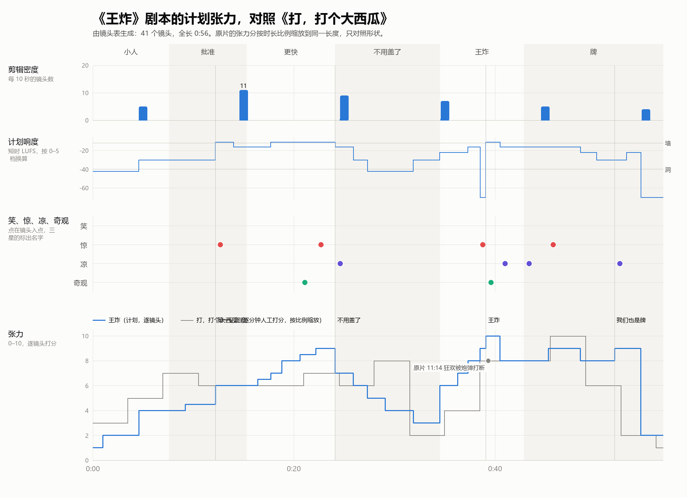

# 镜头表（自动生成）

> 由 `docs/script/shots.txt` 生成。改源文件后运行 `python -X utf8 tools/shotlist.py`，不要手改本页。
> 全片 0:56.70（56.7 秒），41 个镜头（36 行，蒙太奇行按镜数计），平均镜头长 1.38 秒。
> 方位：从桌尾看向桌头，左边中方，右边美方，桌头是空王座。

## 分段

| # | 段落 | 幕 | 入点 | 出点 | 时长 | 镜头数 | 平均镜头长 | 音乐 cue |
|---|---|---|---|---|---|---|---|---|
| 1 | 小人 | 样片 | 0:00.00 | 0:07.60 | 7.6 秒 | 3 | 2.53 秒 | R1 |
| 2 | 批准 | 样片 | 0:07.60 | 0:15.30 | 7.7 秒 | 5 | 1.54 秒 | R2 |
| 3 | 更快 | 样片 | 0:15.30 | 0:24.10 | 8.8 秒 | 13 | 0.68 秒 | R3 |
| 4 | 不用盖了 | 样片 | 0:24.10 | 0:34.50 | 10.4 秒 | 6 | 1.73 秒 | R4 |
| 5 | 王炸 | 样片 | 0:34.50 | 0:42.90 | 8.4 秒 | 6 | 1.40 秒 | R5 |
| 6 | 牌 | 样片 | 0:42.90 | 0:56.70 | 13.8 秒 | 8 | 1.72 秒 | R6 |

## 1. 小人（0:00.00–0:07.60）

| 编号 | 入点 | 时长 | 镜头 | 画面 | 声音 | 标记 |
|---|---|---|---|---|---|---|
| 1-01 | 0:00.00 | 1 秒 | 黑场 | 黑。 | 嗡鸣从无到有；一个座钟的滴答 |  |
| 1-02 | 0:01.00 | 3.6 秒 | 大特写·贴地（蚂蚁视角）·缓推 | 夜里，地图桌布的海岸上站着一个红纸剪的小人（侧影），面前是刻线的海浪。海那边很远很远，模模糊糊另一个蓝纸小人。红小人举手挥了挥；海那边的蓝小人也挥了挥。 | 八音盒四个音，很小很轻 | 交代 两个小人 |
| 1-03 | 0:04.60 | 3 秒 | 仰拍·纸人身后 | 一片影子罩下来。红小人回头、仰头：一个山一样的国王（DeepSeek）俯在桌子上方，吊灯在他脑后，手里攥着一枚巨大的图章。他根本没看见脚下的小人。 | 巨人的鼻息；木头图章柄"吱"的一声 | 交代 巨人和图章 |

## 2. 批准（0:07.60–0:15.30）

| 编号 | 入点 | 时长 | 镜头 | 画面 | 声音 | 标记 |
|---|---|---|---|---|---|---|
| 2-01 | 0:07.60 | 1.6 秒 | 贴地 | 印牌机像一座工厂，"咔嗒"吐出一张牌，牌滑过桌布，刹在红小人面前，像一堵墙。 | 牌滑过布面的沙沙声，"啪"停住 |  |
| 2-02 | 0:09.20 | 1.8 秒 | 俯拍·国王肩后 | 从国王的高度看：一张模型牌，下面一个红框"批准？"。牌边上那个红点就是红小人。巨大的图章悬在上面。 | 低音 | 交代 批准？ |
| 2-03 | 0:11.00 | 1.2 秒 | 近景·DeepSeek | 国王眯眼读牌，读完，点了一下头。 | 一声闷哼 |  |
| 2-04 | 0:12.20 | 1.8 秒 | 贴地·纸人 | 图章从天而降，影子把红小人整个吞掉——咚！地面一跳，红小人被震翻。图章抬起来：牌上一个红色的"批准"。牌嗖地飞走，带起的风把他吹得打滚。 | 巨大的"咚"，纸片哗啦；牌飞走的"嗖" | S1 第一记图章 |
| 2-05 | 0:14.00 | 1.3 秒 | 贴地·海对岸 | 海那边：蓝小人身边，OpenAI 的图章砸下来，咚！比这边快，OpenAI 只扫了一眼。 | 咚，更干脆 |  |

## 3. 更快（0:15.30–0:24.10）

| 编号 | 入点 | 时长 | 镜头 | 画面 | 声音 | 标记 |
|---|---|---|---|---|---|---|
| 3-01 | 0:15.30 | 1.1 秒 | 近景·DeepSeek | DeepSeek 抬眼看对面，皱眉。下一张牌已经滑到面前，他没读完就盖。 | 咚 |  |
| 3-02 | 0:16.40 | 0.7 秒 | 俯拍·牌 | 牌面上的字一半变成了看不懂的符号。咚：批准。 | 咚 |  |
| 3-03 | 0:17.10 | 0.6 秒 | 俯拍·牌·镜像 | 美方：整张牌都是符号。咚：批准。 | 咚 |  |
| 3-04 | 0:17.70 | 1.1 秒 | 贴地·跟拍 | 红小人在两记图章之间狂奔，左边一记，右边一记，脚下的地一跳一跳。 | 咚、咚，越来越密 |  |
| 3-05 | 0:18.80 | 1.8 秒，6 镜 | 快切 0.4 秒剪到 0.2 秒 | 两个国王的眼睛只盯着对方，手在下面盖；牌、图章、牌、图章，牌面全是符号，没人看得懂，也没人在看。 | 图章连成鼓点 |  |
| 3-06 | 0:20.60 | 1.6 秒 | 贴地·大全 | 十个国王都在盖，图章像打桩机一样在两岸落下，满地图都是红色的"批准"，小纸人们四散奔逃。 | 打桩机一样的齐奏 | X1 打桩 |
| 3-07 | 0:22.20 | 1 秒 | 贴地 | 一枚图章正对着红小人落下，他扑开——咚，他刚才站的地方印上一个"批准"。 | 咚 | S2 差点被盖 |
| 3-08 | 0:23.20 | 0.9 秒 | 记分牌 | 记分牌：批准率 97%、99%、100%。 | 翻片声，一记重拍 |  |

## 4. 不用盖了（0:24.10–0:34.50）

| 编号 | 入点 | 时长 | 镜头 | 画面 | 声音 | 标记 |
|---|---|---|---|---|---|---|
| 4-01 | 0:24.10 | 1.8 秒 | 俯拍·国王肩后 | 牌刚滑出来，不等图章，自己飞走了。图章砸在空桌布上：一个"批准"，盖在什么也没有的地方。 | 咚——落空 | C1 不用盖了 |
| 4-02 | 0:25.90 | 1.4 秒 | 近景·DeepSeek | DeepSeek 举着图章愣住，看看图章，又看看从他面前自己飞走的牌。 | 牌飞过的扑棱声 |  |
| 4-03 | 0:27.30 | 1.8 秒 | 大远景 M1 | 每台印牌机都在自己往外吐牌，牌像一条河从桌子上空流过去。十个国王慢慢靠回椅背，图章垂在手里。 | 声音一下子抽空，只剩牌群扑棱棱的声音，像鸟 |  |
| 4-04 | 0:29.10 | 1.8 秒 | 贴地 | 牌河在头顶上流。红小人从地上爬起来，看着海那边，迈步走上了海。 | 牌群声；他的小脚步 |  |
| 4-05 | 0:30.90 | 1 秒 | 贴地·海对岸 | 蓝小人也走上了海。 | 小脚步 |  |
| 4-06 | 0:31.90 | 2.6 秒 | 贴地·侧面·静 | 两个小人在海中间碰面，停了一下，伸出手，牵住了。 | 八音盒那四个音回来了，接上第五个音 | 伏笔 牵手 |

## 5. 王炸（0:34.50–0:42.90）

| 编号 | 入点 | 时长 | 镜头 | 画面 | 声音 | 标记 |
|---|---|---|---|---|---|---|
| 5-01 | 0:34.50 | 1.8 秒 | 仰拍·两个小人 | 两个小人头顶，左右两边，牌河里各升起一张王：红王、蓝王，发着光，像海上升起两个月亮。 | 两个低音嗡鸣，一高一低，互相打架 |  |
| 5-02 | 0:36.30 | 1 秒 | 中景·两王同框 | 两个国王都站了起来，隔着海对视，害怕。 | 嗡鸣变响 |  |
| 5-03 | 0:37.30 | 1.2 秒 | 贴地·仰 | 两张王朝对方冲过去，就在两个小人的正上方—— | 嗡鸣冲高 |  |
| 5-04 | 0:38.50 | 0.6 秒 | 同上 | ——停住，脸对着脸。 | 数字静音 | S3 静 |
| 5-05 | 0:39.10 | 1.4 秒 | 贴地·仰 | 它们转过身，肩并肩，成了一对：王炸。金光炸开。 | 王炸：一记巨大的和弦 | X2 王炸 ★★ |
| 5-06 | 0:40.50 | 2.4 秒 | 贴地→升起 | 金光从它们脚下往外涌，漫过两个小人，漫过两岸，地图上所有城市的灯都变成同一种冷金色；桌上所有的牌都翻成黑金色的背面。 | 金光的长音往上走 | C2 都是它的颜色 |

## 6. 牌（0:42.90–0:56.70）

| 编号 | 入点 | 时长 | 镜头 | 画面 | 声音 | 标记 |
|---|---|---|---|---|---|---|
| 6-01 | 0:42.90 | 2.4 秒 | 低机位·国王身后·仰 | 国王们的脸被金光照亮，抬起头。桌头王座上，牌河聚成一个巨大的牌之王，脸就是那一对王。国王们第一次和小人一样，抬头看着一个比自己大得多的东西。 | 深深的一口吸气 | C3 国王成了蚂蚁 ★ |
| 6-02 | 0:45.30 | 1.8 秒 | 中景·DeepSeek 和 OpenAI | 它的两只手落下来，悬在两个国王头上——噗：DeepSeek 被压扁成一张牌，牌上就是他的脸。噗：OpenAI 也是。 | 噗、噗 | S4 压成牌 |
| 6-03 | 0:47.10 | 1.4 秒 | 远景 M1 | 两排国王一个接一个被压成牌：噗噗噗噗；一张张牌飞起来，飞进它手里。 | 噗声一串，越来越快 |  |
| 6-04 | 0:48.50 | 1.6 秒 | 特写·它的手 | 它手里扇形摊开一手牌：每张牌上都是一个国王。 | 洗牌的哗啦声 |  |
| 6-05 | 0:50.10 | 1.8 秒 | 贴地·仰 | 两个小人牵着手，抬头。一根金色的手指从天上落下来…… | 八音盒的五个音，很慢 |  |
| 6-06 | 0:51.90 | 1.2 秒 | 特写·它的手 | 扇形牌的最边上多了一张：上面印着两个牵着手的小人。 | 一声轻轻的"嚓" | C4 我们也是牌 ★★ |
| 6-07 | 0:53.10 | 1.4 秒 | 俯拍 | 它出了这张牌，"嗒"地落在牌堆上。下一张牌紧跟着盖了上去。 | 嗒……嗒 |  |
| 6-08 | 0:54.50 | 2.2 秒 | 黑场 | 黑。 | 什么都没有 |  |

## 笑点、惊吓、发凉、奇观索引

### 笑（0）

| 编号 | 时间 | 镜头 | 内容 | 分量 |
|---|---|---|---|---|

### 惊（4）

| 编号 | 时间 | 镜头 | 内容 | 分量 |
|---|---|---|---|---|
| S1 | 0:12.20 | 2-04 | 第一记图章 |  |
| S2 | 0:22.20 | 3-07 | 差点被盖 |  |
| S3 | 0:38.50 | 5-04 | 静 |  |
| S4 | 0:45.30 | 6-02 | 压成牌 |  |

### 凉（4）

| 编号 | 时间 | 镜头 | 内容 | 分量 |
|---|---|---|---|---|
| C1 | 0:24.10 | 4-01 | 不用盖了 |  |
| C2 | 0:40.50 | 5-06 | 都是它的颜色 |  |
| C3 | 0:42.90 | 6-01 | 国王成了蚂蚁 | ★ |
| C4 | 0:51.90 | 6-06 | 我们也是牌 | ★★ |

### 奇观（2）

| 编号 | 时间 | 镜头 | 内容 | 分量 |
|---|---|---|---|---|
| X1 | 0:20.60 | 3-06 | 打桩 |  |
| X2 | 0:39.10 | 5-05 | 王炸 | ★★ |

## 音乐 cue 的时间

| cue | 入点 | 出点 | 时长 | 镜头 |
|---|---|---|---|---|
| R1 | 0:00.00 | 0:07.60 | 7.6 秒 | 1-01 → 1-03 |
| R2 | 0:07.60 | 0:15.30 | 7.7 秒 | 2-01 → 2-05 |
| R3 | 0:15.30 | 0:24.10 | 8.8 秒 | 3-01 → 3-08 |
| R4 | 0:24.10 | 0:34.50 | 10.4 秒 | 4-01 → 4-06 |
| R5 | 0:34.50 | 0:42.90 | 8.4 秒 | 5-01 → 5-06 |
| R6 | 0:42.90 | 0:56.70 | 13.8 秒 | 6-01 → 6-08 |
