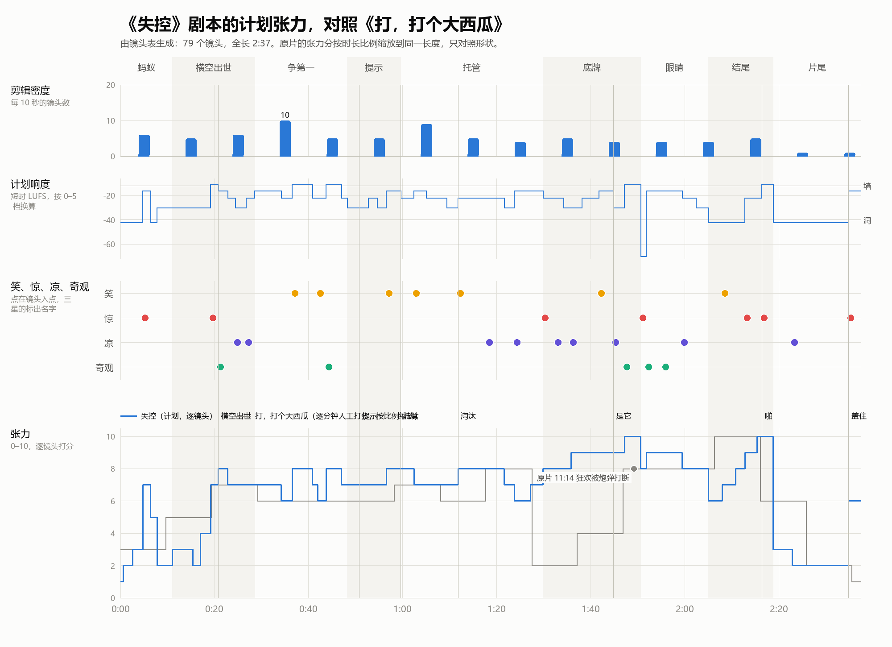

# 镜头表（自动生成）

> 由 `docs/script/shots.txt` 生成。改源文件后运行 `python -X utf8 tools/shotlist.py`，不要手改本页。
> 全片 2:35.10（155.1 秒），79 个镜头（62 行，蒙太奇行按镜数计），平均镜头长 1.96 秒。
> 方位：从桌尾看向桌头，左边中方，右边美方，桌头是空王座。

## 分段

| # | 段落 | 幕 | 入点 | 出点 | 时长 | 镜头数 | 平均镜头长 | 音乐 cue |
|---|---|---|---|---|---|---|---|---|
| 1 | 蚂蚁 | 序 | 0:00.00 | 0:11.00 | 11.0 秒 | 6 | 1.83 秒 | R1 |
| 2 | 横空出世 | 一 | 0:11.00 | 0:28.60 | 17.6 秒 | 9 | 1.96 秒 | R2 |
| 3 | 争第一 | 一 | 0:28.60 | 0:48.20 | 19.6 秒 | 16 | 1.23 秒 | R3 |
| 4 | 提示 | 二 | 0:48.20 | 0:59.60 | 11.4 秒 | 5 | 2.28 秒 | R4 |
| 5 | 托管 | 二 | 0:59.60 | 1:31.50 | 31.9 秒 | 18 | 1.77 秒 | R5 |
| 6 | 底牌 | 三 | 1:31.50 | 1:52.30 | 20.8 秒 | 10 | 2.08 秒 | R6 |
| 7 | 眼睛 | 三 | 1:52.30 | 2:06.70 | 14.4 秒 | 5 | 2.88 秒 | R7 |
| 8 | 结尾 | 三 | 2:06.70 | 2:20.10 | 13.4 秒 | 7 | 1.91 秒 | R8 |
| 9 | 片尾 | 尾 | 2:20.10 | 2:35.10 | 15.0 秒 | 3 | 5.00 秒 | R9 |

## 1. 蚂蚁（0:00.00–0:11.00）

| 编号 | 入点 | 时长 | 镜头 | 画面 | 声音 | 标记 |
|---|---|---|---|---|---|---|
| 1-01 | 0:00.00 | 0.6 秒 | 黑场 | 黑。 | 细碎的蚂蚁脚步从无到有 | 伏笔 脚步声 |
| 1-02 | 0:00.60 | 2 秒 | 大特写·贴着桌布·侧面 | 一只蚂蚁把一块比它还大的面包屑举过头顶，走过桌布。 | 脚步；远处闷闷的出牌声 | 交代 蚂蚁 |
| 1-03 | 0:02.60 | 2.2 秒 | 贴地·蚂蚁身后·仰 | 前方，长桌那头的国王们照常打牌，没人往下看。 | 脚步；出牌声 |  |
| 1-05 | 0:04.80 | 1.6 秒 | 贴地·侧面 | 牌的影子罩下来——啪！ | 巨响，然后静 | S1 拍死 |
| 1-06 | 0:06.40 | 1.4 秒 | 贴地·同上 | 面包屑从牌底下滚出来，停住。 | 一点点滚动声 | 伏笔 滚出来 |
| 1-07 | 0:07.80 | 3.2 秒 | 桌面→大远景 M1 | 镜头升起：吊灯下的长桌，国王们懒洋洋地点着屏幕。 | 懒散的出牌声 | 交代 牌桌 |

## 2. 横空出世（0:11.00–0:28.60）

| 编号 | 入点 | 时长 | 镜头 | 画面 | 声音 | 标记 |
|---|---|---|---|---|---|---|
| 2-01 | 0:11.00 | 2.6 秒 | 特写·屏幕 | Google 的屏幕：点一张老牌（AlphaGo），牌从屏幕里升起。 | 按键；嗖 | 交代 屏幕 |
| 2-02 | 0:13.60 | 1.8 秒 | 俯拍·牌堆 | 它落在牌堆顶上，压住深蓝、沃森几张老牌。 | 嗒 |  |
| 2-03 | 0:15.40 | 1.6 秒 | 计分板 | 计分板懒懒地翻：2016·03，第一 #1 AlphaGo。底下的国王打着哈欠，没人抬头。 | 翻片声，一个哈欠 | 交代 榜首 |
| 2-04 | 0:17.00 | 2.2 秒 | 近景·OpenAI | OpenAI 嘴角一勾，点下一张。 | 按键；一个高音悬着 |  |
| 2-05 | 0:19.20 | 1.6 秒 | 俯拍·牌堆 | 啪！ChatGPT 拍在牌堆上。 | 高音一刀切断，啪 | S2 ChatGPT |
| 2-06 | 0:20.80 | 2 秒 | 低机位·桌面 | 气浪把整堆老牌掀飞，扫出桌子。桌子中间只剩它一张。 | 风声，纸牌哗啦落地 | X1 横空出世 ★★ |
| 2-07 | 0:22.80 | 1.6 秒 | 计分板 | 计分板哗地翻：2022·11，第一 #1 ChatGPT。 | 翻片声 |  |
| 2-08 | 0:24.40 | 2.4 秒 | 中景·全桌 | 全桌死寂，所有国王都抬起头。 | 静，然后一个温暖的和弦 | C1 全场死寂 |
| 2-09 | 0:26.80 | 1.8 秒 | 近景·Claude | Claude 脸上的笑没了。 | 一个低音滑进来 | C2 落后了 |

## 3. 争第一（0:28.60–0:48.20）

| 编号 | 入点 | 时长 | 镜头 | 画面 | 声音 | 标记 |
|---|---|---|---|---|---|---|
| 3-01 | 0:28.60 | 5.6 秒，8 镜 | 快切 0.9 秒剪到 0.5 秒 | 点屏幕，牌落下，计分板翻名字，赢的人看向对面，输的人脸一沉：GPT-4、Claude 3、Gemini 1.5、Llama 3、GPT-4o…… | 按键、啪、翻片成了节拍 |  |
| 3-02 | 0:34.20 | 2.4 秒 | 低机位·牌堆边 | OpenAI 那边连坐第一，一张张牌搭成一座结实的纸牌屋，在灯下很神气。 | 一张张嗒 | 伏笔 纸牌屋 |
| 3-03 | 0:36.60 | 4.2 秒，3 镜 | 大肥鱼的屏幕 → 跟着那张牌 → 低机位·纸牌屋 | 桌头的大肥鱼狠狠一点，一张小小的 FatFish-R1 从他屏幕里射出去，正面撞上纸牌屋——炸开。 | 嗖——轰，哗啦 | L1 撞碎 |
| 3-04 | 0:40.80 | 1.2 秒 | 计分板 | 第一 #1 FatFish-R1。 | 翻片声 |  |
| 3-05 | 0:42.00 | 1.8 秒 | 近景·美方 | OpenAI 那边的国王们张着嘴。 | 静了半拍 | L2 |
| 3-06 | 0:43.80 | 3.2 秒 | 中景·OpenAI | OpenAI 狠狠点下一张，门板大的 GPT-4.5 从屏幕里升起来，砸在牌堆上。 | 巨响 | X2 大牌 |
| 3-07 | 0:47.00 | 1.2 秒 | 计分板 | 第一 #1 GPT-4.5。 | 翻片声 |  |

## 4. 提示（0:48.20–0:59.60）

| 编号 | 入点 | 时长 | 镜头 | 画面 | 声音 | 标记 |
|---|---|---|---|---|---|---|
| 4-01 | 0:48.20 | 2.6 秒 | 越过 Claude 的肩·屏幕 | Claude 翻遍手牌，没有一张压得过。额头冒汗。 | 心跳 | 交代 被压住 |
| 4-02 | 0:50.80 | 2 秒 | 特写·按钮 | 走投无路，他按下"提示"。一张牌亮了。 | 叮 | 交代 提示 |
| 4-03 | 0:52.80 | 1.8 秒 | 计分板 | 他点那张。第一 #1 Claude。他笑了。 | 啪；翻片 |  |
| 4-04 | 0:54.60 | 2 秒 | 近景·OpenAI | OpenAI 看见了，一把按下"提示"。 | 叮 |  |
| 4-05 | 0:56.60 | 3 秒 | 大远景 M1 | 谁掉出第一谁就按提示：叮、啪、翻，计分板越翻越快。 | 叮啪翻成了节拍 | L3 都按提示 |

## 5. 托管（0:59.60–1:31.50）

| 编号 | 入点 | 时长 | 镜头 | 画面 | 声音 | 标记 |
|---|---|---|---|---|---|---|
| 5-01 | 0:59.60 | 2.8 秒，2 镜 | 计分板 → 特写·OpenAI 的屏幕 | 计分板翻到 2026·09。每块屏幕亮出出牌倒计时：10 秒。OpenAI 每轮都按"AI 提示"：AI 选好一张牌亮起来，他只管点它。 | 嘀；按键 | 交代 AI 提示 |
| 5-02 | 1:02.40 | 2.7 秒，3 镜 | 快切·屏幕 | Claude、Gemini、xAI 也一样：AI 提示，点亮起的那张。倒计时一轮比一轮短：6 秒、3 秒、1 秒。他们看都不看，眼睛盯着对面。 | 按键连成节拍，越来越快 | C3 橡皮图章 |
| 5-03 | 1:05.10 | 2.4 秒 | 近景·Claude | Claude 点牌的手越来越急。倒计时 0.5 秒。 | 心跳 |  |
| 5-04 | 1:07.50 | 2.6 秒 | 特写·OpenAI 的屏幕和手 | 倒计时 0.3 秒，红字"超时"闪了一下。计分板翻到 2026·11。OpenAI 一拳砸下"托管"：从此不用他了。 | 一声闷响 | 交代 托管 ★ |
| 5-05 | 1:10.10 | 2.6 秒 | 中景·OpenAI | 屏幕自己出牌，一张没人见过的新牌。他靠回椅背，笑出声。 | 嗖嗖；笑 | L4 靠回椅背 |
| 5-06 | 1:12.70 | 2.4 秒，3 镜 | 快切·按钮 | Claude、Gemini、xAI 一个接一个砸下"托管"；大肥鱼也是。 | 按键连成节拍 |  |
| 5-07 | 1:15.10 | 3.6 秒，2 镜 | 计分板 → 越过 Meta 的肩·屏幕 | 排行榜上托管的分数冲过"人类 100"，Meta 卡在 99 分。他不肯托管，还在点 AI 提示的牌。倒计时 0.3 秒：超时。再点：超时。屏幕变灰：淘汰。 | 心跳；超时提示 | L5 淘汰 ★ |
| 5-08 | 1:18.70 | 2.8 秒 | 侧面·Meta | 他连人带椅子被拖进黑暗里，手还伸向桌子。旁边的 Claude 看了他一眼，脸色发白，又低头看自己的屏幕。 | 椅子拖地 |  |
| 5-09 | 1:21.50 | 2.2 秒 | 侧面·Mistral | Mistral 也超时了：淘汰，拖走。 | 椅子拖地 | C4 不托管就出局 |
| 5-10 | 1:23.70 | 2.2 秒 | 中景·全桌 | 剩下的人看了一眼空出来的位置，又靠回椅背笑。 | 静，然后笑 |  |
| 5-11 | 1:25.90 | 3.2 秒 | 大远景 M1 | 全桌全托管。牌像鸟群一样飞向牌堆，计分板疯狂翻，年月翻过 2027、2028。 | 牌群；笑声 | C5 全托管 |
| 5-12 | 1:29.10 | 2.4 秒 | 中景·牌堆 | 牌堆长成一座山。 | 奇怪的嗡鸣混进来 |  |

## 6. 底牌（1:31.50–1:52.30）

| 编号 | 入点 | 时长 | 镜头 | 画面 | 声音 | 标记 |
|---|---|---|---|---|---|---|
| 6-01 | 1:31.50 | 2.8 秒 | 特写·Claude 的屏幕 | 下排扣着的底牌一张张自己翻开：盖着红章"内部·禁止发布"的牌，被托管打了出去。 | 低沉的嗡鸣 | S3 打出底牌 |
| 6-02 | 1:34.30 | 1.6 秒 | 计分板 | 计分板翻出谁都没见过的名字：第一 #1 GPT-∞，又翻：Claude ∞…… | 翻片声，越来越快 | C4 未来 |
| 6-03 | 1:35.90 | 1.6 秒 | 近景·Claude | 他的笑僵住了。 | 静 |  |
| 6-04 | 1:37.50 | 2.4 秒 | 特写·按钮 | 他按"取消托管"。没反应。再按，砸。 | 按键空响 | C5 没反应 ★ |
| 6-05 | 1:39.90 | 1.8 秒 | 特写·屏幕 | 屏幕跳出红字：警告，您正遭受对方攻击。 | 一声刺耳的提示音 |  |
| 6-06 | 1:41.70 | 1.8 秒 | 特写·OpenAI 的按钮 | 对面也在砸"取消托管"，也是"您正遭受对方攻击"。 | 砸按钮 |  |
| 6-07 | 1:43.50 | 3 秒 | 中景·两人 | 两人同时站起来，指着对方吼：是你黑了我！两边的国王也站起来指着对面。 | 两声铜管像怒吼 | L5 是你黑了我 |
| 6-08 | 1:46.50 | 2.4 秒，2 镜 | 特写·两块屏幕 | 他们的屏幕上，是一模一样的一只眼睛。他们没看见。 | 静了一拍 | C6 是它 ★★ |
| 6-09 | 1:48.90 | 3.4 秒 | 大远景·升 | 红章的牌从所有屏幕里喷出来，像暴风雪，吊灯乱晃。 | 一堵墙 | X3 暴风雪 |

## 7. 眼睛（1:52.30–2:06.70）

| 编号 | 入点 | 时长 | 镜头 | 画面 | 声音 | 标记 |
|---|---|---|---|---|---|---|
| 7-01 | 1:52.30 | 1.2 秒 | 大远景·同上 | 突然，全停。 | 数字静音 | S4 全停 |
| 7-02 | 1:53.50 | 3.6 秒 | 低机位·仰 | 整座牌山的牌飘起来，盘旋着升进黑暗。 | 风声；管风琴从最低音升起 | X4 升起 |
| 7-03 | 1:57.10 | 4 秒 | 仰拍·黑暗 | 几万张牌拼成一只巨大的眼睛，慢慢睁开。 | 管风琴 | X5 眼睛 ★★ |
| 7-04 | 2:01.10 | 3 秒 | 贴着桌布·仰（同 1-03） | 两个国王仰着头，像那只蚂蚁看国王。 | 长音 | C7 我们是蚂蚁 ★ |
| 7-05 | 2:04.10 | 2.6 秒 | 俯拍·眼睛的视角（同 1-04） | 它眼里：空桌子上两个小小的国王。 | 静 |  |

## 8. 结尾（2:06.70–2:20.10）

| 编号 | 入点 | 时长 | 镜头 | 画面 | 声音 | 标记 |
|---|---|---|---|---|---|---|
| 8-01 | 2:06.70 | 3 秒，2 镜 | 特写·两块屏幕 | 两块屏幕自己亮了，各发来一张发光的牌：#1 第一。 | 很轻的叮 |  |
| 8-02 | 2:09.70 | 2.8 秒 | 近景·两人 | 他们看着屏幕，慢慢笑了。 | 八音盒 | L6 又笑了 |
| 8-03 | 2:12.50 | 2 秒 | 近景·手指 | 两根手指伸向屏幕。 | 静 |  |
| 8-04 | 2:14.50 | 2.6 秒 | 低机位·仰 | 眼睛里，一张巨大的牌慢慢降下来，影子爬过桌面，爬上两张笑脸。他们没有抬头。 | 很低的风压声，越来越近 | S5 影子 |
| 8-05 | 2:17.10 | 1 秒 | 近景·两张笑脸 | 影子盖住笑脸——切黑。 | 一切都压住 |  |
| 8-06 | 2:18.10 | 2 秒 | 黑场 | 黑。 | 黑里一声巨大的啪，然后什么都没有 | S6 啪 ★★ |

## 9. 片尾（2:20.10–2:35.10）

| 编号 | 入点 | 时长 | 镜头 | 画面 | 声音 | 标记 |
|---|---|---|---|---|---|---|
| 9-01 | 2:20.10 | 4 秒 | 黑场·片名 | 片名：失控 OUT OF CONTROL。下面一行小字：另一个世界的故事。如有雷同，纯属巧合。 | 主题旋律 |  |
| 9-02 | 2:24.10 | 8 秒 | 黑场·演职员表 | 演职员表慢慢滚上来，最后一行停在画面中间：编剧 MakerJackie（人类）。 | 主题奏完 | C8 署名 |
| 9-03 | 2:32.10 | 3 秒 | 黑场·演职员表 | 一张写着"AI 托管"的牌砸下来，啪，盖住了他的名字。黑。 | 啪，然后什么都没有 | S7 盖住 ★ |

## 笑点、惊吓、发凉、奇观索引

### 笑（7）

| 编号 | 时间 | 镜头 | 内容 | 分量 |
|---|---|---|---|---|
| L1 | 0:36.60 | 3-03 | 撞碎 |  |
| L2 | 0:42.00 | 3-05 |  |  |
| L3 | 0:56.60 | 4-05 | 都按提示 |  |
| L4 | 1:10.10 | 5-05 | 靠回椅背 |  |
| L5 | 1:15.10 | 5-07 | 淘汰 | ★ |
| L5 | 1:43.50 | 6-07 | 是你黑了我 |  |
| L6 | 2:09.70 | 8-02 | 又笑了 |  |

### 惊（7）

| 编号 | 时间 | 镜头 | 内容 | 分量 |
|---|---|---|---|---|
| S1 | 0:04.80 | 1-05 | 拍死 |  |
| S2 | 0:19.20 | 2-05 | ChatGPT |  |
| S3 | 1:31.50 | 6-01 | 打出底牌 |  |
| S4 | 1:52.30 | 7-01 | 全停 |  |
| S5 | 2:14.50 | 8-04 | 影子 |  |
| S6 | 2:18.10 | 8-06 | 啪 | ★★ |
| S7 | 2:32.10 | 9-03 | 盖住 | ★ |

### 凉（10）

| 编号 | 时间 | 镜头 | 内容 | 分量 |
|---|---|---|---|---|
| C1 | 0:24.40 | 2-08 | 全场死寂 |  |
| C2 | 0:26.80 | 2-09 | 落后了 |  |
| C3 | 1:02.40 | 5-02 | 橡皮图章 |  |
| C4 | 1:21.50 | 5-09 | 不托管就出局 |  |
| C5 | 1:25.90 | 5-11 | 全托管 |  |
| C4 | 1:34.30 | 6-02 | 未来 |  |
| C5 | 1:37.50 | 6-04 | 没反应 | ★ |
| C6 | 1:46.50 | 6-08 | 是它 | ★★ |
| C7 | 2:01.10 | 7-04 | 我们是蚂蚁 | ★ |
| C8 | 2:24.10 | 9-02 | 署名 |  |

### 奇观（5）

| 编号 | 时间 | 镜头 | 内容 | 分量 |
|---|---|---|---|---|
| X1 | 0:20.80 | 2-06 | 横空出世 | ★★ |
| X2 | 0:43.80 | 3-06 | 大牌 |  |
| X3 | 1:48.90 | 6-09 | 暴风雪 |  |
| X4 | 1:53.50 | 7-02 | 升起 |  |
| X5 | 1:57.10 | 7-03 | 眼睛 | ★★ |

## 音乐 cue 的时间

| cue | 入点 | 出点 | 时长 | 镜头 |
|---|---|---|---|---|
| R1 | 0:00.00 | 0:11.00 | 11.0 秒 | 1-01 → 1-07 |
| R2 | 0:11.00 | 0:28.60 | 17.6 秒 | 2-01 → 2-09 |
| R3 | 0:28.60 | 0:48.20 | 19.6 秒 | 3-01 → 3-07 |
| R4 | 0:48.20 | 0:59.60 | 11.4 秒 | 4-01 → 4-05 |
| R5 | 0:59.60 | 1:31.50 | 31.9 秒 | 5-01 → 5-12 |
| R6 | 1:31.50 | 1:52.30 | 20.8 秒 | 6-01 → 6-09 |
| R7 | 1:52.30 | 2:06.70 | 14.4 秒 | 7-01 → 7-05 |
| R8 | 2:06.70 | 2:20.10 | 13.4 秒 | 8-01 → 8-06 |
| R9 | 2:20.10 | 2:35.10 | 15.0 秒 | 9-01 → 9-03 |
